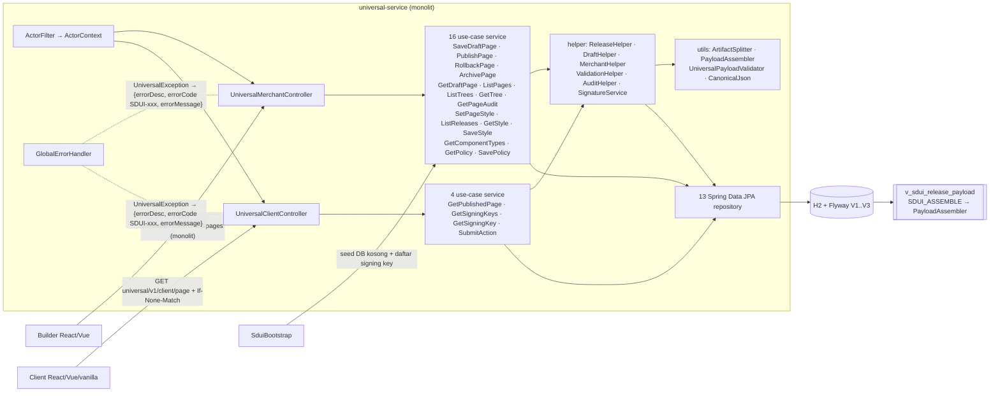
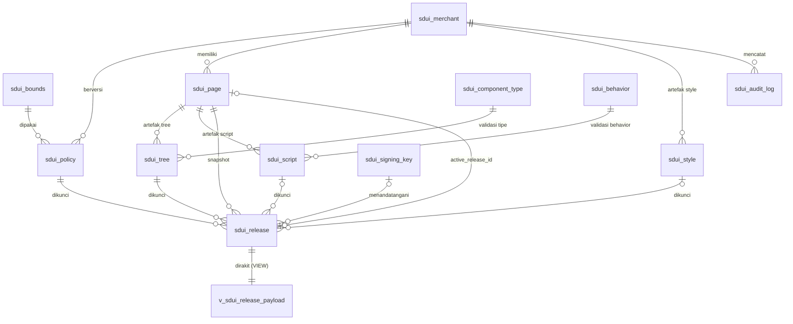
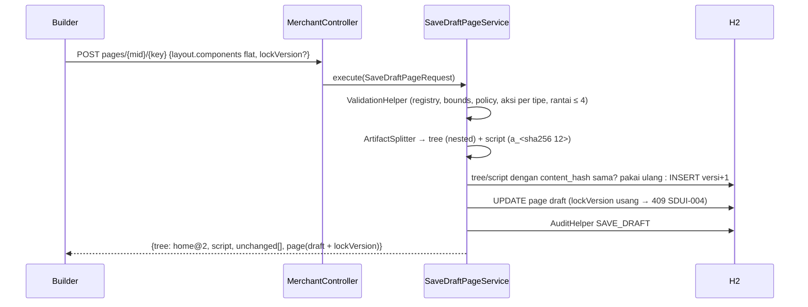

# HANDOFF — universal-service (backend SDUI)

> Tanggal: 2026-11-10 · Versi: 0.2.0-SNAPSHOT (belum di-commit)
> Desain: `packages/sdui/docs/DESAIN-SISTEM-SDUI.md` (§12 = deviasi implementasi H2)
> Pasangan: `packages/sdui/HANDOFF.md`, `react-tailwind/HANDOFF.md`, `vue-bootstrap/HANDOFF.md`

## 1. Apa ini
Spring Boot 4.1 (Java 17) **monolit** yang menyimpan halaman SDUI sebagai **3 artefak blob** (style milik merchant,
tree + script milik page) di **H2**, membekukan hasil rakit ke **release** immutable, dan menyajikannya ke client
dengan ETag (+ envelope Ed25519 opsional). Keputusan: **S1 + A1** — builder kirim monolit, server memecah; client terima bundle.

Struktur kode mengikuti pola service Maverick (`C:\maverick\backend-service\*`): **satu class service per use case**
(`execute(request)`), record request/response dengan `@RecordBuilder`, JPA entity + Spring Data repository,
enum Fault + exception, konstanta di `utils/constants`, `application.yml`, `build.gradle.kts`, `lombok.config`,
log `@Log4j2`, tes Mockito per service + MockMvc standalone per controller.
**Tidak** memakai library foundation Maverick (internal BNI, tidak dibutuhkan): pola ditiru, bukan dependensinya.

## 2. Desain sistem

### 2.1 Arsitektur


### 2.2 Model data (ERD ringkas)

| Tabel | Entity | Sifat | Isi |
|---|---|---|---|
| `sdui_page` | `SduiPage` (BaseEntity) | **mutable**, `VERSION` = optimistic lock | draft tree/script/style, `active_release_id`, status |
| `sdui_merchant`, `sdui_component_type`, `sdui_behavior` | BaseEntity | mutable (registry) | tenant; 18 tipe; 9 behavior |
| `sdui_tree` / `sdui_script` | CreatedEntity + `@Immutable` | insert-only, per page | body JSON (tree bersarang `nodes[]`; script `actions{}` + `events[]`), `content_hash` |
| `sdui_style` | CreatedEntity + `@Immutable` | insert-only, per merchant | `tokens{kategori:{nama:nilai}}` + `shared{nama:css}` |
| `sdui_policy`, `sdui_bounds` | CreatedEntity + `@Immutable` | insert-only, berversi | allow-list domain/event; batas validasi |
| `sdui_release` | `SduiRelease` (`@DynamicUpdate`) | fill-once, tak bisa dihapus | refs + `policy_version` + `payload` beku + `content_hash` (= ETag) + `signature` |
| `sdui_signing_key`, `sdui_audit_log` | CreatedEntity | registry / append-only | kunci publik; jejak SAVE_DRAFT/PUBLISH/ROLLBACK/… (`created_by` = actor) |
| `v_sdui_release_payload` | `SduiReleasePayloadView` (`@Immutable`) | view | payload rakitan + `unresolved_refs` + `node_count` |

Kolom audit mengikuti pola Maverick: `CREATED_BY, CREATED_TIME` (+ `UPDATED_BY, UPDATED_TIME, VERSION` pada tabel mutable),
diisi JPA auditing dari `ActorContext` (header `X-SDUI-Actor`; default `builder` untuk merchant API, `system` lainnya, `seed` saat startup).

### 2.3 Alur simpan (S1) — `SaveDraftPageService`


### 2.4 Alur publish / rollback / baca — `PublishPageService`, `RollbackPageService`, `GetPublishedPageService`
```mermaid
sequenceDiagram
  participant M as Merchant API
  participant R as ReleaseHelperService
  participant DB as H2
  participant C as Client
  M->>R: publish (atau rollback?to=n): page dikunci PESSIMISTIC_WRITE
  R->>DB: INSERT release (sequence = max+1, policy terbaru)
  R->>DB: SELECT FROM v_sdui_release_payload (SDUI_ASSEMBLE)
  alt ada ref tak terselesaikan
    R-->>M: 400 SDUI-005 (transaksi rollback)
  else
    R->>DB: isi payload + content_hash (+ signature bila aktif) — fill-once
    R->>DB: active_release_id = baru; audit PUBLISH/ROLLBACK (+SIGN)
  end
  C->>DB: GET client/page (GetPublishedPageService)
  DB-->>C: payload beku byte-identik, ETag = content_hash (304 bila sama)
```
Rakit di view: flatten pre-order (→ `parentId` + `order`), style **shared < token < inline**, `actionRef → props.action`.
Preset per tipe **tidak** diterapkan server (tugas library sdui di client).

### 2.5 Kontrak
- **Payload A1**: `{pageId, pageKey, merchantId, status:"PUBLISHED", schemaVersion, version, releaseSequence, publishedAt, policy{…}, layout{type, title?, subtitle?, components[]}}`.
- **Envelope** (`?signed=true`): `{schemaVersion, alg:"ed25519", keyId, payload: base64(bytes), signature}`.
- **Error** (semua endpoint): `{errorDesc: "<FAULT>", errorCode: "SDUI-<nnn>", errorMessage, timestamp}`, status HTTP dari `UniversalFault`.

| Fault | Kode | HTTP |
|---|---|---|
| PAGE_NOT_FOUND / PUBLISHED_PAGE_NOT_FOUND | 001 / 002 | 404 |
| INVALID_PAYLOAD | 003 | 400 |
| LOCK_CONFLICT | 004 | 409 |
| UNRESOLVED_REFERENCE | 005 | 400 |
| RELEASE / TREE / STYLE_NOT_FOUND | 006 / 007 / 008 | 404 |
| INVALID_STYLE / INVALID_POLICY / NO_DRAFT / SIGNING_DISABLED | 009 / 010 / 011 / 012 | 400 |
| SIGNING_FAILED / POLICY_NOT_FOUND | 013 / 014 | 500 |
| ACTION_REQUIRED · INTEGRITY_VIOLATION · BAD_REQUEST · GENERAL_ERROR | 015 · 016 · 098 · 099 | 400 · 409 · 400 · 500 |

## 3. Status
| | |
|---|---|
| Tes | `gradlew test` → **38 tes lulus**: unit Mockito (SaveDraftPage 3, PublishPage 3, GetPublishedPage 4, SubmitAction 4, Signature 4), validator 8, controller MockMvc 4, integrasi H2 store 7, signing 1 |
| Migrasi | V3 diterapkan ke DB file yang sudah ada (`schema 2 → v3`) tanpa kehilangan data — terverifikasi |
| Smoke test (port 8090) | ✅ client 200 + ETag, 304, draft, simpan tanpa perubahan, 409 lock usang, 400 tipe tak dikenal, releases, component-types, audit actor dari header, 404 kontrak error |

## 4. Menjalankan
```bash
./gradlew bootRun          # http://localhost:8080/api/universal/v1/...
./gradlew test             # + laporan coverage: build/reports/coverage
```
**Perhatian (mesin ini):** `~/.gradle/init.gradle.kts` perusahaan mewajibkan `catalog.package` dan membuat build
gagal (`Gradle catalog module [catalog.package] is required`). Jalankan dengan Gradle home terpisah:
```bash
GRADLE_USER_HOME=<folder-lain> GRADLE_RO_DEP_CACHE=$HOME/.gradle/caches ./gradlew test
```
(salin `~/.gradle/wrapper/dists` ke `<folder-lain>/wrapper/` agar distribusi Gradle tidak diunduh ulang).

**Wajib setelah update ini:** run IntelliJ yang masih memakai kode lama harus di-restart. DB `data/h2` sudah di
V3 (kolom `lock_version`, `created_at`, … di-rename), sehingga kode lama akan gagal saat menyimpan.

Reset data: hentikan server, hapus `data/h2/`, jalankan lagi → seed ulang dari classpath.

## 5. Peta kode
```
com.fajekrina.universal
├── UniversalApplication                @ConfigurationPropertiesScan
├── config/        ActorContext, ActorFilter, JpaAuditingConfig, AppConfig, CorsConfig, SduiBootstrap
│   └── properties/   SigningProperties (sdui.signing), SeedProperties (sdui.seed)
├── controller/    UniversalClientController, UniversalMerchantController, GlobalErrorHandler
├── db/            ImmutableRowTrigger, ReleaseGuardTrigger, SduiDbFunctions   (H2 trigger/alias)
├── model/
│   ├── dto/       ValidationBounds, ComponentRegistry
│   ├── entity/    CreatedEntity, BaseEntity, Sdui* (12 tabel + view)
│   ├── enums/     PageStatus, AuditEvent
│   ├── request/   PageBody, SubmitActionBody (HTTP) + *Request per use case
│   └── response/  *Response per use case, ErrorResponse
├── repository/    Sdui*Repository (Spring Data JPA)
├── service/       *Service (1 use case = 1 class) + *HelperService (dipakai bersama) + SignatureService
└── utils/         ArtifactSplitter, PayloadAssembler, UniversalPayloadValidator, CanonicalJson
    ├── constants/ Constants
    ├── converter/ JsonStringListConverter
    ├── enums/     UniversalFault
    └── exception/ UniversalException
resources/
├── application.yml                     context-path /api, H2 file + AUTO_SERVER, Flyway, sdui.*
├── db/migration/V1..V3                 skema, seed registry, kolom audit
└── data/universal/{policies,pages}     seed untuk DB kosong
```

## 6. API (base `/api/universal/v1`)
Client (`/client`): `GET page/{mid}/{key}[?signed=true]` (ETag, If-None-Match → 304) · `GET signing-keys` →
`{keys:[…]}` · `GET signing-key` (deprecated) · `POST action/submit`.

Merchant (`/merchant`, header opsional `X-SDUI-Actor`):
`GET pages/{mid}` · `GET|POST|DELETE pages/{mid}/{key}` (DELETE = archive) · `POST pages/{mid}/{key}/publish` ·
`POST pages/{mid}/{key}/rollback?to={seq}` · `GET pages/{mid}/{key}/trees` (`{trees:[…]}`) · `GET pages/{mid}/{key}/trees/{v}` ·
`GET pages/{mid}/{key}/audit` (`{entries:[…]}`) · `PUT pages/{mid}/{key}/style {styleKey, version?}` ·
`GET releases/{mid}/{key}` (`{releases:[…]}`) · `GET|PUT styles/{mid}/{styleKey}` · `GET component-types` · `GET|PUT policies/{mid}`.

**Berubah dari versi sebelumnya:** prefix `/api/universal` → `/api/universal/v1`; body error `{error}` →
`{errorDesc, errorCode, errorMessage, timestamp}`; daftar release/tree/audit/keys dibungkus objek. Library sdui dan
kedua demo sudah disesuaikan.

## 7. Aturan yang ditegakkan
- Artefak, policy, bounds immutable (trigger DB + `@Immutable` Hibernate). Release: kolom lain tak bisa berubah; payload/signature hanya sekali isi; tidak bisa dihapus.
- Simpan dengan isi sama tidak membuat versi baru (`content_hash`).
- Publish gagal (400 SDUI-005) bila ada `token`/`sharedStyle`/`actionRef` tak terselesaikan; transaksi di-rollback.
- Sequence release monoton (page dikunci saat publish); rollback = release baru dengan refs lama + policy terbaru.
- Optimistic lock page: `lockVersion` usang → 409; update bersamaan → 409 (`ObjectOptimisticLockingFailureException`).
- FK komposit mencegah page memakai style/tree/script merchant lain.

## 8. Diketahui / belum
- H2 tanpa jsonb: tidak ada query JSON di SQL. Pindah ke PostgreSQL = ganti V1–V3 sesuai desain asli; kontrak API tetap.
- `hibernate.ddl-auto: none` (Flyway pemilik skema); belum ada tes `validate` skema vs entity.
- Tidak ada autentikasi/otorisasi; `X-SDUI-Actor` dipercaya apa adanya (hanya untuk audit).
- H2 console tidak diaktifkan (IDE terhubung via `AUTO_SERVER=TRUE`).
- Kunci signing: satu kunci aktif dari config; rotasi (RETIRED/REVOKED) belum ada endpoint-nya.
- Folder lama `./data/universal/pages` (runtime file store) tidak dipakai lagi.
- GC artefak/draft yang tidak pernah dirilis belum ada.

## 9. Langkah berikut
1. Restart run IntelliJ dengan kode ini; commit.
2. Auth (merchant API) → isi actor dari identitas, bukan header.
3. Endpoint rotasi signing key; status RETIRED/REVOKED dihormati client.
4. Unit test Mockito untuk service yang belum punya (SaveStyle, SetPageStyle, ListReleases, …) — saat ini tercakup tes integrasi.
5. Bila produksi: PostgreSQL + jsonb sesuai `packages/sdui/docs/DESAIN-SISTEM-SDUI.md` §4.
