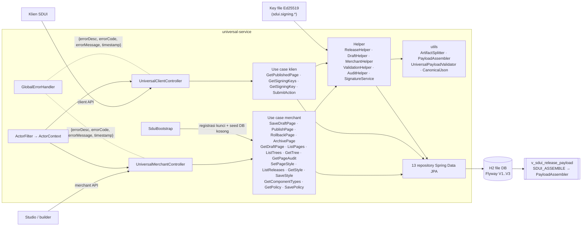
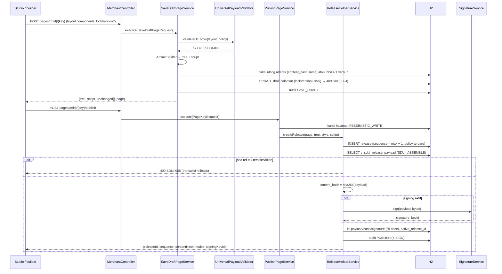
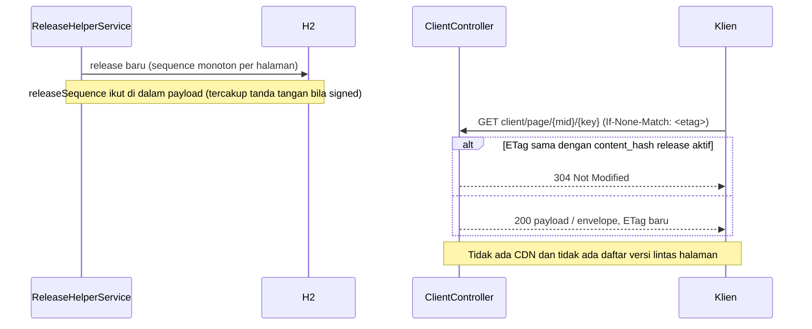
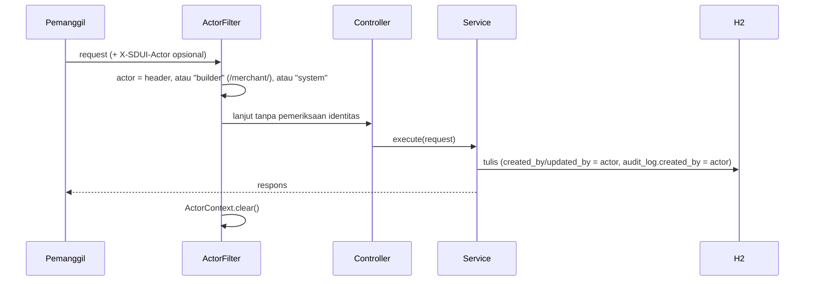
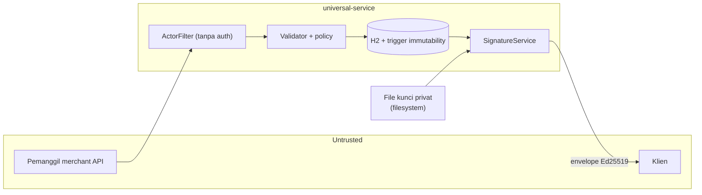

# HLD — `universal-service` (Backend Penerbit Payload SDUI)

## 0. Metadata

| Field | Nilai |
| :--- | :--- |
| Judul | High Level Design — `universal-service` |
| Versi dokumen | 1.0 |
| Versi build | `0.2.0-SNAPSHOT` (`gradle.properties`) |
| Status | As-built |
| Tanggal | 2026-11-12 |
| Pemilik | fajekrina |
| Sumber kebenaran | Kode di repo `universal-service` (working tree), migrasi Flyway `V1..V3`, `application.yml`. Bila dokumen dan kode berbeda, kode yang berlaku. |

## Daftar Isi

- [1. Overview](#1-overview)
- [2. Architecture](#2-architecture)
- [3. Data Flow](#3-data-flow)
- [4. API Surface](#4-api-surface)
- [5. Conceptual Model](#5-conceptual-model)
- [6. Dependencies & Constraints](#6-dependencies--constraints)
- [7. Developer Experience](#7-developer-experience)
- [8. Non-Functional Requirements](#8-non-functional-requirements)
- [9. Security & Threat Model](#9-security--threat-model)
- [10. Known Limitations & Open Questions](#10-known-limitations--open-questions)
- [Self-check](#self-check)

---

## 1. Overview

### 1.1 Kapabilitas

1. **Penyimpanan halaman sebagai tiga artefak**: builder mengirim halaman monolit (`layout.components` datar); server memecahnya menjadi artefak **tree** dan **script** milik halaman, sementara **style** adalah artefak milik merchant yang dipakai bersama banyak halaman.
2. **Artefak immutable dan berversi**: artefak, policy, dan bounds bersifat insert-only (trigger DB + `@Immutable` Hibernate). Simpan dengan isi sama tidak membuat versi baru (dedupe `content_hash` SHA-256).
3. **Release beku**: publish membuat release dengan `sequence` monoton per halaman, merakit payload sekali lewat view `v_sdui_release_payload`, lalu membekukan payload dan `content_hash`. Release tidak dapat dihapus; kolom payload/signature hanya dapat diisi sekali.
4. **Rollback sebagai release baru**: `rollback?to={seq}` membuat release baru dengan refs artefak dari release lama dan policy terbaru.
5. **Penyajian ke klien dengan ETag**: payload release aktif disajikan byte-identik; `ETag = content_hash`, `If-None-Match` → `304`.
6. **Envelope Ed25519 opsional**: `?signed=true` mengembalikan envelope bertanda tangan; kunci publik tersedia di `GET client/signing-keys`.
7. **Validasi saat simpan berbasis data**: tipe komponen, behavior yang diizinkan per tipe, bounds, dan policy merchant (allow-list domain/event) dibaca dari tabel registry.
8. **Audit trail**: setiap SAVE_DRAFT, PUBLISH, ROLLBACK, ARCHIVE, SIGN, STYLE_SAVE, POLICY_SAVE dicatat dengan actor dari header `X-SDUI-Actor`.
9. **Seed awal**: database kosong diisi dari `classpath:data/universal/{policies,pages}` melalui alur simpan + publish yang sama dengan builder.

### 1.2 Ruang lingkup

| In scope | Out of scope |
| :--- | :--- |
| Merchant API (penulisan draft, publish, rollback, archive, style, policy, registry) | Engine klien, renderer, dan konversi payload di klien — lihat HLD Paket |
| Client API (payload release, envelope bertanda tangan, kunci publik, handler aksi demo) | UI aplikasi FE dan builder — lihat HLD Clients FE |
| Skema DB, migrasi Flyway, trigger immutability, view perakitan | Penerbitan manifest bertanda tangan — tidak ada di build saat ini |
| Signing Ed25519 dengan kunci dari file konfigurasi | HSM/KMS, rotasi kunci terkelola — tidak ada di build saat ini |
| Validasi payload saat simpan | Autentikasi, otorisasi, rate limiting — tidak ada di build saat ini |
| Audit log | Resolusi aset ke CDN — tidak ada di build saat ini |

### 1.3 Target pengguna

| Pengguna | Kebutuhan |
| :--- | :--- |
| Tim penulis layar | Menyimpan draft, melihat riwayat tree, publish dan rollback halaman |
| Admin merchant | Mengelola style merchant dan policy (allow-list domain/event) |
| Studio / builder (React, Vue) | Palet komponen (`component-types`), baca draft terakit, simpan monolit dengan `lockVersion` |
| CI/CD | `./gradlew test` + laporan coverage JaCoCo. Workflow CI tidak ada di repo. |

### 1.4 Related Documents

| Dokumen | Lokasi | Isi |
| :--- | :--- | :--- |
| HLD Paket | `packages/sdui/HLD-sdui-framework.md` | Engine klien, verifikasi envelope, cache, renderer |
| HLD Clients FE | Belum tersedia di workspace (`react-tailwind/HANDOFF.md`, `vue-bootstrap/HANDOFF.md` sebagai catatan operasional) | Aplikasi FE dan builder |
| `spec/` | `packages/sdui/spec/` | Kontrak bersama: bentuk envelope, schema payload, bounds |
| `HANDOFF.md` | Root repo ini | Catatan operasional dan status tes |

---

## 2. Architecture

### 2.1 Keputusan arsitektur

| # | Keputusan | Alasan |
| :--- | :--- | :--- |
| AD-1 | **Monolit Spring Boot, satu modul Gradle** | Satu unit deploy; batas use case dijaga di level class, bukan modul. |
| AD-2 | **Satu class service per use case** (`execute(request)`) + helper bersama | Use case terisolasi dan dapat diuji per class dengan Mockito. |
| AD-3 | **Tiga artefak blob (tree, script, style) + release beku** | Style dipakai ulang lintas halaman; tree dan script berversi independen; release membekukan kombinasi yang dipublikasikan. |
| AD-4 | **Builder kirim monolit, server memecah; klien menerima bundle terakit** | Builder dan klien tidak perlu memahami pemecahan artefak; satu implementasi perakitan (`PayloadAssembler`). |
| AD-5 | **Immutability ditegakkan database** | Trigger `ImmutableRowTrigger` / `ReleaseGuardTrigger` menolak UPDATE/DELETE terlepas dari kode aplikasi. |
| AD-6 | **Perakitan payload di view** (`v_sdui_release_payload` → `SDUI_ASSEMBLE`) | Satu tempat definisi perakitan; ref yang tak terselesaikan terdeteksi sebelum release dibekukan. |
| AD-7 | **Fail-closed saat publish** | Ref `token`/`sharedStyle`/`actionRef` yang tak terselesaikan → `400 SDUI-005`, transaksi di-rollback. Signing aktif tetapi gagal → `500 SDUI-013`. |
| AD-8 | **Payload byte-identik + ETag dari hash** | Hash stabil per release; klien merevalidasi murah dengan `If-None-Match`. |
| AD-9 | **Validasi dari data registry** | Tipe komponen, behavior, dan bounds diubah lewat migrasi data, bukan konstanta kode. |
| AD-10 | **Flyway pemilik skema** (`ddl-auto: none`) | Skema deterministik dan dapat diaudit; Hibernate tidak menghasilkan DDL. |

### 2.2 Diagram komponen



### 2.3 Service Catalog

| Service | Status | Tanggung jawab | Kontrak | Lokasi kode |
| :--- | :--- | :--- | :--- | :--- |
| Screen Composer API | Ada | Simpan draft monolit, pecah menjadi artefak, publish, rollback, archive | `POST/GET/DELETE merchant/pages/{mid}/{key}`, `…/publish`, `…/rollback` | `controller/UniversalMerchantController`, `service/SaveDraftPageService`, `PublishPageService`, `RollbackPageService`, `ArchivePageService`, `ReleaseHelperService`, `utils/ArtifactSplitter`, `utils/PayloadAssembler` |
| Component Catalog Service | Ada | Palet komponen aktif + vocabulary behavior | `GET merchant/component-types` | `service/GetComponentTypesService`, tabel `sdui_component_type`, `sdui_behavior` |
| Props Schema Registry | Sebagian | Kolom `props_schema` per tipe tersimpan, tetapi tidak dipakai validator dan tidak diekspos endpoint | — | `model/entity/SduiComponentType.propsSchema` |
| Validation Service | Ada | Validasi saat simpan: JSON Schema bundel, registry tipe/behavior, bounds, policy | Dipanggil internal oleh `SaveDraftPageService` | `service/ValidationHelperService`, `utils/UniversalPayloadValidator`, `resources/universal-schema.json` |
| Signing Service | Ada | Tanda tangan Ed25519 atas bytes payload, `keyId`, kunci publik mentah | `GET client/signing-keys`, `?signed=true` | `service/SignatureService`, `GetSigningKeysService`, `config/SduiBootstrap` |
| Manifest Publisher | Tidak ada di build saat ini | — | — | — |
| Asset Resolver | Tidak ada di build saat ini | Nilai `src` gambar disimpan dan disajikan apa adanya | — | — |
| Token Validator | Tidak ada di build saat ini | `X-SDUI-Actor` dipercaya apa adanya, hanya untuk audit | — | `config/ActorFilter` |
| Rate Limiter | Tidak ada di build saat ini | — | — | — |

Service pendukung yang juga ada:

| Service | Tanggung jawab | Lokasi kode |
| :--- | :--- | :--- |
| Release Reader | Payload release aktif, ETag, envelope; menandatangani release lama saat diminta (fill-once) | `service/GetPublishedPageService` |
| Style & Policy | Artefak style merchant, policy berversi | `SaveStyleService`, `GetStyleService`, `SetPageStyleService`, `SavePolicyService`, `GetPolicyService` |
| Audit | Jejak append-only per merchant/halaman | `AuditHelperService`, `GetPageAuditService` |
| Action Handler (demo) | Handler `POST client/action/submit` untuk alur demo (form, seat, checkout, payment) | `service/SubmitActionService` |

#### Detail singkat

- **Screen Composer API.** `SaveDraftPageService` memvalidasi layout, memecahnya lewat `ArtifactSplitter` menjadi tree bersarang dan script (aksi bernama `a_<sha256 12>`), memakai ulang artefak dengan `content_hash` sama, lalu memperbarui draft dengan optimistic lock (`lockVersion` usang → `409 SDUI-004`). Publish mengunci halaman `PESSIMISTIC_WRITE` dan mendelegasikan ke `ReleaseHelperService.createRelease`.
- **Component Catalog Service.** Mengembalikan tipe yang `enabled` dengan `category`, `acceptsChildren`, `allowedBehaviors`, dan `default_props`, serta behavior yang aktif. Seed: 18 tipe, 9 behavior (`V2__sdui_seed_registry.sql`).
- **Validation Service.** `UniversalPayloadValidator` memuat `universal-schema.json` (JSON Schema Draft 2020-12, `networknt/json-schema-validator`), lalu memeriksa tipe terdaftar, behavior yang diizinkan per tipe, bounds dari `sdui_bounds` terbaru, kedalaman rantai aksi, dan policy (`allowedDomains` untuk behavior `domain`, `allowedEvents` untuk `event`).
- **Signing Service.** Membaca kunci privat (PKCS8) dan publik (X.509 atau raw 32 byte) dari file; `keyId` = 16 hex pertama SHA-256 kunci publik mentah. Tanpa konfigurasi, signing nonaktif dan permintaan bertanda tangan ditolak (`400 SDUI-012`).

### 2.4 Batas modul

Repo berisi **satu modul Gradle** (`settings.gradle.kts`: `rootProject.name = "universal-service"`). Batas ditegakkan per package:

| Package | Isi | Boleh bergantung pada |
| :--- | :--- | :--- |
| `controller` | 2 controller REST + `GlobalErrorHandler` | `service`, `model` |
| `service` | Use case (`*Service`) + helper (`*HelperService`, `SignatureService`) | `repository`, `utils`, `model`, `config` (`ActorContext`) |
| `repository` | 13 repository Spring Data JPA | `model.entity` |
| `model` | `entity`, `dto`, `request`, `response`, `enums` | — |
| `utils` | `ArtifactSplitter`, `PayloadAssembler`, `UniversalPayloadValidator`, `CanonicalJson`, `Constants`, `UniversalFault`, `UniversalException` | `model.dto` |
| `db` | Trigger dan fungsi H2 (`ImmutableRowTrigger`, `ReleaseGuardTrigger`, `SduiDbFunctions`) | `utils.PayloadAssembler` |
| `config` | `ActorFilter`, `ActorContext`, auditing JPA, CORS, `ObjectMapper`, `SduiBootstrap`, properties | `service`, `repository` |

### 2.5 Tech stack

| Lapisan | Teknologi |
| :--- | :--- |
| Runtime | Java 17 (toolchain Gradle) |
| Framework | Spring Boot 4.1.1 (`web`, `validation`, `data-jpa`, `flyway`, `log4j2`) |
| Persistensi | H2 file DB (`./data/h2/sdui`, `AUTO_SERVER=TRUE`), Hibernate, Flyway |
| JSON | Jackson (`databind`, `jsr310`), `networknt/json-schema-validator` 1.4.1 |
| Kriptografi | JCA `Signature("Ed25519")` |
| Kode boilerplate | Lombok, `record-builder` 53 |
| Build & tes | Gradle Kotlin DSL, JUnit Platform, Mockito, MockMvc, JaCoCo |
| Logging | Log4j2 (`spring-boot-starter-logging` dikecualikan) |

---

## 3. Data Flow

### 3.1 Authoring: Studio → Composer → Validation → Signing → Publish



Bentuk payload yang dirakit: `{pageId, pageKey, merchantId, status, schemaVersion, version, releaseSequence, publishedAt, policy, layout{type, title?, subtitle?, components[]}}`, dengan komponen datar (`parentId` + `order`), style digabung **shared < token < inline**, dan `actionRef` di-resolve menjadi `props.action`. Preset tampilan per tipe tidak diterapkan server.

### 3.2 Manifest: sequence → sign → distribusi → klien

Manifest bertanda tangan **tidak ada di build saat ini**. Yang ada adalah `sequence` release per halaman dan revalidasi per halaman melalui ETag:



### 3.3 Auth: actor → audit (tanpa validasi token)

Validasi token dan rate limiting **tidak ada di build saat ini**. Alur yang berjalan:



### 3.4 Asset: nama aset → URL

Asset Resolver **tidak ada di build saat ini**. Nilai `props.src` disimpan dan disajikan apa adanya:

```mermaid
sequenceDiagram
  participant S as Studio / builder
  participant SVC as universal-service
  participant K as Klien

  S->>SVC: layout dengan Image.props.src = "<string>"
  SVC->>SVC: validasi string (bounds panjang); tidak ada resolusi
  SVC-->>K: payload dengan src yang sama
  Note over K: Resolusi nama aset (bila ada) dilakukan di klien
```

---

## 4. API Surface

Base path: `/api/universal/v1` (`server.servlet.context-path: /api`). Semua respons `application/json`.

### 4.1 Endpoint penerbitan payload

| Method | Path | Fungsi | Respons |
| :--- | :--- | :--- | :--- |
| `GET` | `client/page/{mid}/{key}` | Payload release aktif | `200` payload + `ETag` + `Cache-Control: no-cache, private`; `304` bila `If-None-Match` cocok; `404 SDUI-002` |
| `GET` | `client/page/{mid}/{key}?signed=true` | Envelope bertanda tangan | `200` envelope; `400 SDUI-012` bila signing nonaktif |
| `POST` | `client/action/submit` | Handler aksi demo | `200` / `400` `{success, message, data, target, navigateTo, …}` |
| `GET` | `merchant/pages/{mid}` | Daftar halaman | `{pages:[…]}` |
| `GET` | `merchant/pages/{mid}/{key}` | Draft terakit + `lockVersion` | `DraftPageResponse` |
| `POST` | `merchant/pages/{mid}/{key}` | Simpan draft monolit | `SaveDraftPageResponse` |
| `DELETE` | `merchant/pages/{mid}/{key}` | Archive (release tetap tersimpan; client API → `404`) | `ArchivePageResponse` |
| `POST` | `merchant/pages/{mid}/{key}/publish` | Publish draft | `ReleaseResponse` |
| `POST` | `merchant/pages/{mid}/{key}/rollback?to={seq}` | Rollback ke release `seq` (release baru) | `ReleaseResponse` |
| `GET` | `merchant/pages/{mid}/{key}/trees` · `…/trees/{v}` | Riwayat dan isi tree | `{trees:[…]}` · `TreeResponse` |
| `GET` | `merchant/pages/{mid}/{key}/audit` | Jejak audit halaman | `{entries:[…]}` |
| `PUT` | `merchant/pages/{mid}/{key}/style` | Pasang style `{styleKey, version?}`; `styleKey: null` melepas | `DraftPageResponse` |
| `GET` | `merchant/releases/{mid}/{key}` | Daftar release | `{releases:[…]}` |
| `GET` · `PUT` | `merchant/styles/{mid}/{styleKey}[?version=]` | Baca / simpan style | `StyleResponse` |
| `GET` · `PUT` | `merchant/policies/{mid}` | Baca / simpan policy | `PolicyResponse` · `SavePolicyResponse` |

Envelope (`?signed=true`) berbentuk sesuai `spec/`: `{schemaVersion, alg: "ed25519", keyId, payload: base64(bytes payload), signature}`. Isi `payload` adalah payload A1 di §3.1; bentuk ini berbeda dari schema payload `spec/`, dan penerjemahannya terjadi di klien (lihat HLD Paket).

### 4.2 Endpoint manifest

Tidak ada di build saat ini.

### 4.3 Endpoint catalog

| Method | Path | Respons |
| :--- | :--- | :--- |
| `GET` | `merchant/component-types` | `{components: {Type: {category, acceptsChildren, allowedBehaviors, props}}, behaviors: [...]}` — `props` berisi `default_props` |

File statis turut disajikan dari `static/universal/`: `components.json` (registry komponen JSON Schema) dan `panel-components.json` (contoh nilai untuk panel drag-drop). `props_schema` per tipe tidak diekspos.

### 4.4 Endpoint asset

Tidak ada di build saat ini.

### 4.5 Error model

Semua error memakai satu bentuk dari `GlobalErrorHandler`:

```json
{ "errorDesc": "PUBLISHED_PAGE_NOT_FOUND", "errorCode": "SDUI-002", "errorMessage": "…", "timestamp": "…" }
```

| Fault | Kode | HTTP | Pemetaan di klien (`SduiError`) |
| :--- | :--- | :--- | :--- |
| `PAGE_NOT_FOUND` / `PUBLISHED_PAGE_NOT_FOUND` | 001 / 002 | 404 | `unknownScreen` (lewat `universalScreenProvider`) atau `http(404)` → `notFound` |
| `INVALID_PAYLOAD` | 003 | 400 | `http(400)` → `rejected` |
| `LOCK_CONFLICT` | 004 | 409 | `http(409)` → `rejected` |
| `UNRESOLVED_REFERENCE` | 005 | 400 | `http(400)` → `rejected` |
| `RELEASE_NOT_FOUND` / `TREE_NOT_FOUND` / `STYLE_NOT_FOUND` | 006 / 007 / 008 | 404 | `http(404)` → `notFound` |
| `INVALID_STYLE` / `INVALID_POLICY` / `NO_DRAFT` / `SIGNING_DISABLED` | 009 / 010 / 011 / 012 | 400 | `http(400)` → `rejected` |
| `SIGNING_FAILED` / `POLICY_NOT_FOUND` | 013 / 014 | 500 | `http(500)` → `unavailable` |
| `ACTION_REQUIRED` | 015 | 400 | `http(400)` → `rejected` |
| `INTEGRITY_VIOLATION` | 016 | 409 | `http(409)` → `rejected` |
| `BAD_REQUEST` | 098 | 400 (atau status framework: 404/405/415) | `http(status)` |
| `GENERAL_ERROR` | 099 | 500 | `http(500)` → `unavailable` |

Klien membaca `errorMessage` dan `errorCode` dari body menjadi `message` dan `serverCode` pada `SduiError.http`.

### 4.6 Versioning kebijakan penerbit

| Hal | Kebijakan |
| :--- | :--- |
| Path API | Versi di path: `/api/universal/v1` |
| `schemaVersion` | Disimpan per tree (`^[0-9]+\.[0-9]+$`); default `1.0` (`Constants.DEFAULT_SCHEMA_VERSION`); dibawa ke payload dan envelope |
| Artefak | Versi integer naik per `(page, artefak)`; isi sama tidak menaikkan versi |
| Release | `sequence` monoton per halaman; rollback = sequence baru |
| Policy / bounds | Insert-only berversi; release mengunci `policy_version` |
| Endpoint deprecated | `GET client/signing-key` (satu kunci); pengganti: `GET client/signing-keys` |

### 4.7 Auth model

| Header | Dipakai untuk | Divalidasi |
| :--- | :--- | :--- |
| `X-SDUI-Actor` | `created_by` / `updated_by` dan audit log | Tidak — nilai dipercaya apa adanya |
| `If-None-Match` | Revalidasi ETag di `client/page` | Dicocokkan dengan `content_hash` (mendukung `W/`, daftar, dan `*`) |

Tidak ada validasi token, sesi, atau otorisasi per merchant di build saat ini. CORS: `allowedOriginPatterns("*")`, semua header, `exposedHeaders("ETag")`, `allowCredentials(true)`.

### 4.8 Rate limiting policy

Tidak ada di build saat ini.

---

## 5. Conceptual Model

Model ini mendeskripsikan entitas yang disimpan backend dan relasinya.

| Entitas | Tabel | Sifat | Atribut kunci | Relasi |
| :--- | :--- | :--- | :--- | :--- |
| `Merchant` | `sdui_merchant` | Mutable | `merchant_id` (`^[a-z0-9_]{3,64}$`), `status` (`ACTIVE`/`SUSPENDED`), `default_style_key` | 1 Merchant → N Page, N Style, N Policy, N AuditLog |
| `Page` (ScreenDraft) | `sdui_page` | Mutable, optimistic lock `version` | `page_id`, `page_key`, `status` (`DRAFT`/`PUBLISHED`/`ARCHIVED`), `draft_tree_id`, `draft_script_id`, `draft_style_id`, `active_release_id` | 1 Page → N Tree, N Script, N Release; 0..1 release aktif |
| `Tree` | `sdui_tree` | Insert-only | `version`, `body` (layout + `nodes[]` bersarang), `content_hash`, `schema_version`, `node_count`, `max_depth` | N Tree → 1 Page |
| `Script` | `sdui_script` | Insert-only | `version`, `body` (`actions{}` + `events[]`), `content_hash`, `action_count` | N Script → 1 Page |
| `Style` | `sdui_style` | Insert-only | `style_key`, `version`, `body` (`tokens` + `shared`), `content_hash` | N Style → 1 Merchant; dipakai banyak Page |
| `Release` (ScreenVersion) | `sdui_release` | Fill-once, tidak dapat dihapus | `sequence`, refs `tree_id`/`style_id`/`script_id`, `policy_version`, `payload`, `content_hash`, `signature`, `signing_key_id`, `rollback_of` | N Release → 1 Page; mengunci 1 Tree, 0..1 Style, 0..1 Script, 1 Policy, 0..1 SigningKey |
| `ComponentDefinition` | `sdui_component_type` | Mutable (registry) | `component_type` (`^[A-Z][A-Za-z0-9]{1,31}$`), `category`, `accepts_children`, `default_props`, `allowed_behaviors`, `enabled` | Dipakai validasi Tree |
| `PropsSchema` | Kolom `sdui_component_type.props_schema` | Mutable | JSON Schema props per tipe | Tersimpan, tidak dipakai validator |
| `Behavior` | `sdui_behavior` | Mutable (registry) | `behavior`, `required_fields`, `policy_check` (`domain`/`event`/`none`) | Dipakai validasi Script |
| `Policy` | `sdui_policy` | Insert-only, berversi | `(merchant_id, policy_version)`, `allowed_domains`, `allowed_events`, `bounds_version` | N Policy → 1 Merchant, 1 Bounds |
| `Bounds` | `sdui_bounds` | Insert-only, berversi | `max_depth`, `max_nodes`, `max_string_length`, `max_props`, `max_children`, `max_array_items`, `max_identifier_length`, `max_chain_depth` | Dipakai Policy |
| `SigningKey` | `sdui_signing_key` | Registry | `key_id`, `public_key` (raw 32 byte, base64), `status` (`ACTIVE`/`RETIRED`/`REVOKED`), `merchant_id` (NULL = global) | 1 SigningKey → N Release |
| `AuditLog` | `sdui_audit_log` | Append-only | `event`, `release_id`, `created_by`, `detail` | N AuditLog → 1 Merchant |
| `ManifestVersion` | — | Tidak ada di build saat ini | — | — |
| `ReleasePayload` | View `v_sdui_release_payload` | Read-only | `payload` terakit, `unresolved_refs`, `node_count`, `is_active` | 1:1 dengan Release |

Catatan:
- `Named Target` (peta nama request/link → URL/method) milik aplikasi FE, bukan DB backend. Payload backend memuat URL mentah pada behavior `api` (`url`) dan `externalLink` (`href`), dibatasi oleh `allowed_domains` milik policy merchant.
- FK komposit (`page_id, merchant_id`) dan (`style_id, merchant_id`) mencegah halaman memakai artefak merchant lain.

---

## 6. Dependencies & Constraints

### 6.1 Dependensi

| Dependensi | Peran |
| :--- | :--- |
| Spring Boot 4.1.1 + `io.spring.dependency-management` 1.1.7 | Web, JPA, validasi, Flyway, Log4j2 |
| H2 (`implementation`, bukan runtime-only) | DB sekaligus dependensi kompilasi: trigger dan fungsi view adalah class Java (`org.h2.api.Trigger`) |
| `networknt/json-schema-validator` 1.4.1 | Validasi `universal-schema.json` saat simpan |
| Lombok, `record-builder` 53 | Boilerplate entity dan record |

### 6.2 Kompatibilitas dengan kontrak bersama

| Elemen | Hubungan dengan `spec/` |
| :--- | :--- |
| Envelope | Sesuai `spec/` (`schemaVersion`, `alg`, `keyId`, `payload` base64, `signature`) |
| Kunci publik | Raw 32 byte base64, siap diimpor verifier Ed25519 klien |
| Payload | Format A1 milik backend; tidak berbentuk schema payload `spec/`, diterjemahkan di klien |
| Bounds | Nilai seed `sdui_bounds` v1 = 32 / 5000 / 4096 / 64 / 256 / 512 / 128 / 4, sama dengan default bounds klien; keselarasan tidak ditegakkan tes otomatis |
| Vocabulary aksi | 9 behavior backend (`navigate`, `back`, `submit`, `externalLink`, `openModal`, `closeModal`, `toast`, `customEvent`, `api`), berbeda dari vocabulary aksi `spec/` |

### 6.3 Batasan

- DB H2 file lokal; JSON disimpan sebagai `CLOB` teks, tanpa query JSON di SQL.
- Fungsi perakitan dan trigger bergantung pada mekanisme `CREATE ALIAS` / `CREATE TRIGGER … CALL` khas H2.
- Kunci privat dibaca dari file di filesystem host aplikasi.
- Satu kunci aktif dari konfigurasi; tidak ada endpoint pengelolaan kunci.

---

## 7. Developer Experience

### 7.1 Setup dan menjalankan

```bash
./gradlew bootRun     # http://localhost:8080/api/universal/v1/...
./gradlew test        # 38 tes + laporan coverage di build/reports/coverage
```

Lingkungan dengan init script Gradle global yang mewajibkan modul katalog perusahaan menjalankan build dengan Gradle home terpisah:

```bash
GRADLE_USER_HOME=<folder-lain> GRADLE_RO_DEP_CACHE=$HOME/.gradle/caches ./gradlew test
```

Reset data: hentikan server, hapus `data/h2/`, jalankan ulang → `SduiBootstrap` men-seed dari classpath.

### 7.2 Konfigurasi

| Properti | Default | Fungsi |
| :--- | :--- | :--- |
| `server.port` | `8080` | Port HTTP |
| `spring.datasource.url` | `jdbc:h2:file:./data/h2/sdui;AUTO_SERVER=TRUE` | DB file; IDE dapat terhubung saat aplikasi berjalan |
| `sdui.seed.enabled` | `true` | Seed DB kosong |
| `sdui.signing.enabled` | `false` | Aktifkan signing |
| `sdui.signing.private-key-file` / `public-key-file` | `""` | File kunci (base64 DER atau PEM) |

### 7.3 Migrasi

- Flyway membaca `classpath:db/migration`; skema: `V1__sdui_schema.sql`, seed registry: `V2__sdui_seed_registry.sql`, penyelarasan kolom audit: `V3__align_audit_columns.sql`.
- Migrasi yang sudah diterapkan tidak diubah (checksum Flyway); perubahan skema atau data registry ditambahkan sebagai `V<n>__*.sql` baru.

### 7.4 Menambah komponen ke catalog

1. Tambah migrasi `V<n>__*.sql` yang meng-`INSERT` ke `sdui_component_type` (`component_type`, `category`, `accepts_children`, `default_props`, `allowed_behaviors`, `props_schema`).
2. Bila tipe memerlukan behavior baru, `INSERT` ke `sdui_behavior` dengan `required_fields` dan `policy_check`.
3. Perbarui `universal-schema.json` bila schema bundel membatasi tipe atau props.
4. Pastikan tipe yang sama dikenali di klien (lihat HLD Paket); keselarasan registry backend–klien tidak diuji otomatis.
5. Jalankan `./gradlew test`; `GET merchant/component-types` menampilkan tipe baru setelah restart.

### 7.5 Tes

| Kelas tes | Jumlah | Cakupan |
| :--- | :--- | :--- |
| `SaveDraftPageServiceTest`, `PublishPageServiceTest`, `GetPublishedPageServiceTest`, `SubmitActionServiceTest`, `SignatureServiceTest` | 3 + 3 + 4 + 4 + 4 | Unit Mockito per use case |
| `UniversalPayloadValidatorTest` | 8 | Validator |
| `UniversalClientControllerTest` | 4 | MockMvc standalone |
| `SduiStoreIntegrationTest` | 7 | Integrasi H2: immutability, dedupe, lock, release |
| `SduiSigningIntegrationTest` | 1 | Signing end-to-end |

---

## 8. Non-Functional Requirements

### 8.1 Performa signing / publish

- Publish: satu transaksi dengan kunci `PESSIMISTIC_WRITE` per halaman, satu `INSERT` release, satu perakitan via view, satu `UPDATE` fill-once.
- Signing membaca dan mem-parse file kunci privat **pada setiap tanda tangan** (tanpa cache kunci di memori).
- Baca klien: payload diambil dari kolom beku, tanpa perakitan ulang; `304` tanpa body bila ETag cocok.
- Target numerik (latensi p95, throughput) tidak ditetapkan di repo.

### 8.2 Key rotation SLA

Tidak ditetapkan. Tabel `sdui_signing_key` mendukung status `ACTIVE`/`RETIRED`/`REVOKED`, dan `signing-keys` hanya menyaring `REVOKED`; tidak ada endpoint atau prosedur untuk mengubah status kunci.

### 8.3 Rate limit policy

Tidak ada di build saat ini.

### 8.4 Observability

| Sinyal | Implementasi |
| :--- | :--- |
| Audit trail | `sdui_audit_log`: `SAVE_DRAFT`, `PUBLISH`, `ROLLBACK`, `ARCHIVE`, `SIGN`, `STYLE_SAVE`, `POLICY_SAVE`; `detail` JSON (mis. `sequence`, `policyVersion`, `contentHash`); `GET …/audit` |
| Signing log | Event audit `SIGN` dengan `keyId`; log `info` saat registrasi kunci di startup |
| Log aplikasi | Log4j2: `info` saat release dibuat (`merchant:page@seq`, hash); `error` per fault; `fatal` untuk exception tak tertangani |
| Kolom audit | `CREATED_BY`/`CREATED_TIME` (+ `UPDATED_BY`/`UPDATED_TIME`/`VERSION` pada tabel mutable) via JPA auditing |
| Metrik / tracing | Tidak ada di build saat ini |

### 8.5 Keandalan dan integritas

- Release tidak dapat dihapus; payload dan signature diisi tepat sekali (trigger DB).
- Publish gagal tidak meninggalkan release setengah jadi (rollback transaksi).
- Update bersamaan pada halaman → `409 SDUI-004`.

---

## 9. Security & Threat Model



| Ancaman | Mitigasi yang ada | Celah |
| :--- | :--- | :--- |
| Perubahan payload setelah rilis | Release fill-once + trigger; tanda tangan atas bytes payload beku | — |
| Pemalsuan payload di jalur distribusi | Envelope Ed25519 (`?signed=true`) diverifikasi klien | Payload tanpa `signed=true` tidak bertanda tangan |
| Kebocoran kunci privat | Kunci tidak disimpan di DB; hanya kunci publik di `sdui_signing_key` | Kunci di file biasa; tidak ada HSM/KMS |
| Replay / downgrade | `sequence` monoton per halaman; `releaseSequence` ada di dalam payload bertanda tangan | Tidak ada manifest bertanda tangan; anti-rollback lintas halaman tidak tersedia dari backend |
| Pemanggil tak berwenang menulis halaman | — | Tidak ada autentikasi/otorisasi; `X-SDUI-Actor` dapat dipalsukan |
| Penyalahgunaan volume (DoS) | Bounds membatasi ukuran tree saat simpan | Tidak ada rate limiting |
| URL berbahaya di payload | Behavior `api`/`externalLink` wajib lolos `allowed_domains`; `customEvent` wajib lolos `allowed_events` | Validasi hanya saat simpan; payload membawa URL mentah |
| Akses lintas merchant | FK komposit merchant pada artefak dan release | Endpoint tidak memeriksa identitas merchant pemanggil |
| CORS | `exposedHeaders("ETag")` | `allowedOriginPatterns("*")` bersama `allowCredentials(true)` |

### 9.1 Key custody

Kunci privat Ed25519 dibaca dari `sdui.signing.private-key-file` (PKCS8, base64 DER atau PEM). Kunci publik didaftarkan ke `sdui_signing_key` saat startup bila belum ada. HSM/KMS tidak ada di build saat ini.

### 9.2 Replay protection

`sequence` per halaman dijaga unik (`uq_release_seq`) dan monoton (kunci pessimistic saat publish). `releaseSequence` termasuk dalam bytes yang ditandatangani. Manifest lintas halaman tidak ada di build saat ini.

### 9.3 Token validation

Tidak ada di build saat ini.

### 9.4 Rate limiting

Tidak ada di build saat ini.

---

## 10. Known Limitations & Open Questions

### 10.1 Known Limitations

| # | Limitation |
| :--- | :--- |
| L-1 | Tidak ada autentikasi/otorisasi; `X-SDUI-Actor` hanya untuk audit dan dipercaya apa adanya. |
| L-2 | Tidak ada manifest bertanda tangan; klien yang mengandalkan anti-rollback manifest tidak mendapatkannya dari backend ini. |
| L-3 | Format payload A1 tidak berbentuk schema payload `spec/` dan memuat URL mentah; penerjemahan dan pemetaan ke target bernama terjadi di klien. |
| L-4 | H2 tanpa tipe JSON; JSON disimpan sebagai `CLOB`. Perakitan dan trigger bergantung pada fitur khas H2. |
| L-5 | Satu kunci signing aktif dari konfigurasi; tidak ada endpoint rotasi, retire, atau revoke. |
| L-6 | Kunci privat dibaca dari file setiap kali menandatangani. |
| L-7 | `props_schema` tersimpan tetapi tidak dipakai validator dan tidak diekspos. |
| L-8 | Keselarasan registry komponen, behavior, dan bounds dengan klien tidak diuji otomatis. |
| L-9 | Tidak ada rate limiting, metrik, maupun tracing. |
| L-10 | Tidak ada garbage collection untuk artefak/draft yang tidak pernah dirilis. |
| L-11 | `hibernate.ddl-auto: none` tanpa tes validasi skema vs entity. |
| L-12 | `SubmitActionService` adalah handler demo dengan aturan per nama aksi (`submit`, `SEAT_SELECTION`, `CHECKOUT`, `PAYMENT`), bukan integrasi layanan bisnis. |
| L-13 | Unit test Mockito hanya mencakup sebagian service; sisanya tercakup tes integrasi. |
| L-14 | Tidak ada workflow CI di repo. |

### 10.2 Open Questions

| # | Pertanyaan |
| :--- | :--- |
| Q-1 | Pemetaan CORS memakai pola `/api/**` dan `/api/universal/**`, sementara context path `/api` membuat path di dalam aplikasi berawalan `/universal/…`. Perlu diverifikasi apakah aturan CORS benar-benar diterapkan. |
| Q-2 | Komentar `V2__sdui_seed_registry.sql` menyebut `RegistryContractTest`, tetapi kelas tes tersebut tidak ada di `src/test`. Perlu dipastikan apakah tes kontrak registry direncanakan. |
| Q-3 | Apakah backend akan menerbitkan payload berbentuk `spec/` secara langsung, atau format A1 tetap menjadi kontrak penerbit. |
| Q-4 | Target penyimpanan produksi (PostgreSQL atau lainnya) dan konsekuensinya terhadap trigger serta fungsi perakitan. |

---

## Self-check

| Pemeriksaan | Hasil |
| :--- | :--- |
| Tidak ada bagian yang mendeskripsikan renderer FE | Lulus — UI dan builder dirujuk ke HLD Clients FE |
| Tidak ada bagian yang mendeskripsikan engine klien | Lulus — hanya disebut sebagai pihak yang memverifikasi envelope dan menerjemahkan payload, dengan rujukan ke HLD Paket |
| Rujukan kontrak memakai "sesuai `spec/`" tanpa menyalin isinya | Lulus — envelope dirujuk sesuai `spec/`; perbedaan format payload dinyatakan eksplisit |
| Service yang tidak ada ditandai, tidak dikarang | Lulus — Manifest Publisher, Asset Resolver, Token Validator, Rate Limiter: "tidak ada di build saat ini"; Props Schema Registry: "sebagian" |
| Diagram Mermaid untuk §2.2 dan setiap subbagian §3 | Lulus |
| Present tense, tanpa narasi historis | Lulus |
