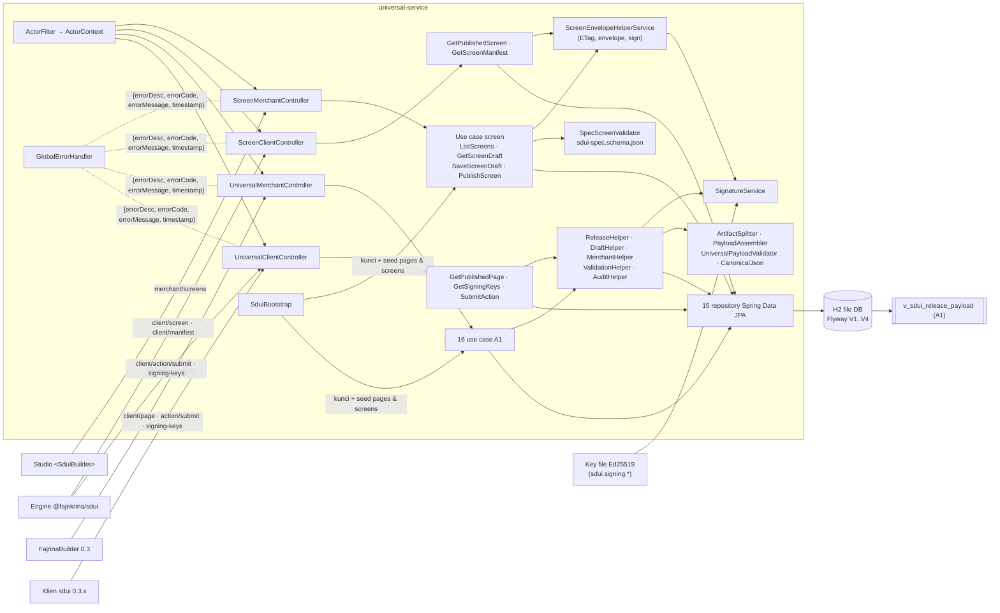
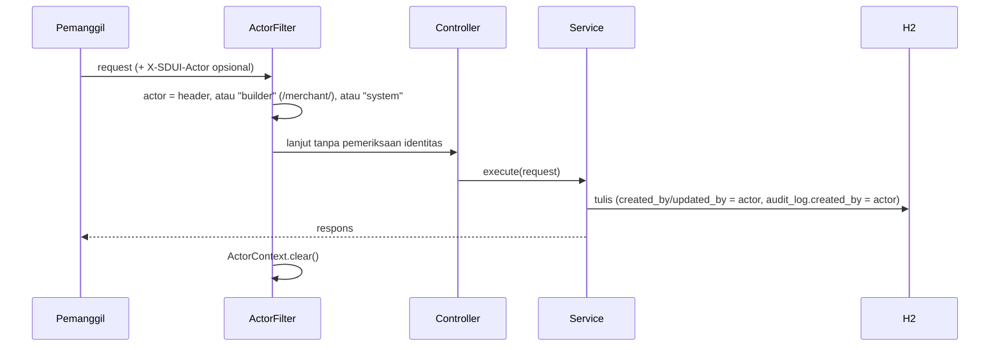
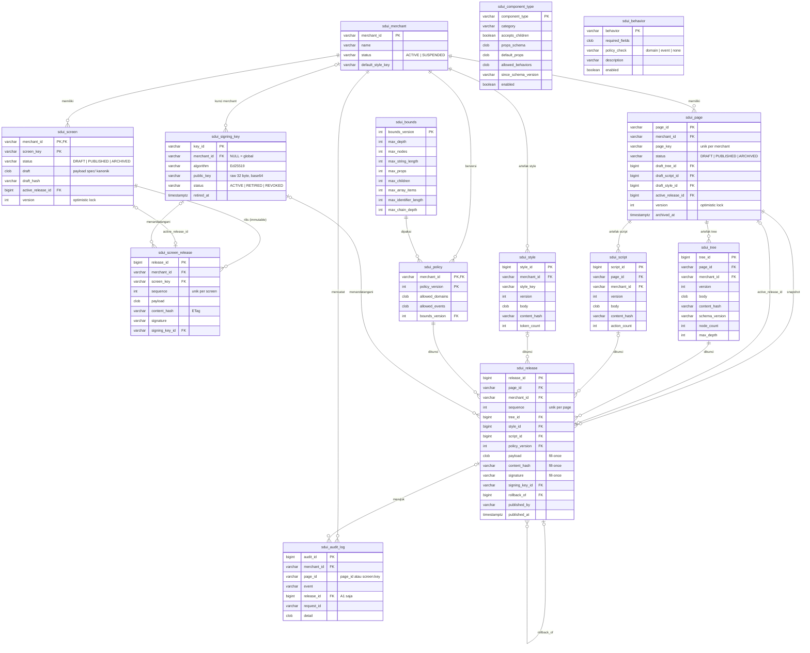
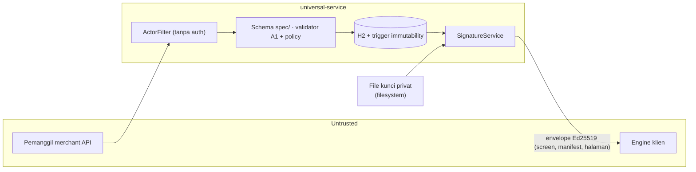

# HLD — `universal-service` (Backend Penerbit Payload SDUI)

## 0. Metadata

| Field | Nilai |
| :--- | :--- |
| Judul | High Level Design — `universal-service` |
| Versi dokumen | 1.1 |
| Versi build | `0.2.0-SNAPSHOT` (`gradle.properties`), branch `feat/spec-screens-demo` |
| Status | As-built |
| Tanggal | 2026-11-12 |
| Pemilik | fajekrina |
| Sumber kebenaran | Kode di repo `universal-service`, migrasi Flyway `V1..V4`, `application.yml`. Bila dokumen dan kode berbeda, kode yang berlaku. |

## Daftar Isi

- [1. Overview](#1-overview)
- [2. Architecture](#2-architecture)
- [3. Data Flow](#3-data-flow)
- [4. API Surface](#4-api-surface)
- [5. Conceptual Model](#5-conceptual-model)
- [6. Dependencies & Constraints](#6-dependencies--constraints)
- [7. Developer Experience](#7-developer-experience)
- [8. Non-Functional Requirements](#8-non-functional-requirements)
- [9. Security & Threat Model](#9-security--threat-model)
- [10. Known Limitations & Open Questions](#10-known-limitations--open-questions)
- [Self-check](#self-check)

---

## 1. Overview

Layanan ini menerbitkan payload SDUI melalui **dua kanal** yang berjalan berdampingan:

| Kanal | Format | Konsumen |
| :--- | :--- | :--- |
| **Spec screen** | `{schemaVersion, screen}` sesuai `spec/` | Engine `@fajekrina/sdui` ≥ 0.4 (`createEngine`, `<SduiScreen>`, `<SduiBuilder>`) |
| **Halaman A1** | `UniversalPageConfig` (`layout.components` datar, 18 tipe PascalCase) | Klien `@fajekrina/sdui` 0.3.x (`loadPage`, `<Fajrina>`, `FajrinaBuilder`) |

### 1.1 Kapabilitas

**Spec screen**

1. **Satu dokumen kanonik per screen**: draft disimpan sebagai JSON terurut kunci (`CanonicalJson.canonical`), divalidasi terhadap `sdui-spec.schema.json` (salinan schema `spec/`), dan `screen.key` wajib sama dengan key di path.
2. **Draft dengan optimistic lock**: simpan dengan isi sama adalah no-op; `lockVersion` usang → `409 SDUI-004`.
3. **Release immutable**: publish membekukan bytes draft sebagai release `sequence = terakhir + 1` per screen, lengkap dengan signature Ed25519 bila signing aktif. Trigger DB menolak UPDATE/DELETE pada release. Publish tanpa perubahan adalah no-op.
4. **Penyajian ke engine**: bytes release aktif disajikan apa adanya dengan `ETag = sha256(bytes)` (`If-None-Match` → `304`), atau sebagai envelope Ed25519 (`?signed=true`).
5. **Manifest versi**: `{sequence, screens: {key: "v<seq>"}}` per merchant, dengan `sequence` yang hanya naik — dipakai cache dan anti-rollback engine klien.

**Halaman A1**

6. **Tiga artefak**: builder mengirim halaman monolit; server memecahnya menjadi **tree** dan **script** milik halaman, sedangkan **style** milik merchant dipakai bersama.
7. **Artefak immutable dan berversi** (dedupe `content_hash`), **release beku** dirakit lewat view `v_sdui_release_payload`, **rollback** sebagai release baru.
8. **Validasi berbasis data registry** (tipe, behavior per tipe, bounds, policy allow-list domain/event).

**Bersama**

9. **Audit trail**: SAVE_DRAFT, PUBLISH, ROLLBACK, ARCHIVE, SIGN, STYLE_SAVE, POLICY_SAVE dengan actor dari `X-SDUI-Actor`.
10. **Seed awal**: tabel kosong diisi dari classpath (`data/universal/{policies,pages,screens}`) melalui use case yang sama dengan builder.

### 1.2 Ruang lingkup

| In scope | Out of scope |
| :--- | :--- |
| Merchant API spec screen (`merchant/screens`) dan A1 (`merchant/pages`, style, policy, registry) | Engine klien, renderer, builder UI — lihat HLD Paket |
| Client API: screen + manifest (`client/screen`, `client/manifest`), halaman A1, kunci publik, handler aksi demo | UI aplikasi FE — lihat HLD Clients FE |
| Skema DB, migrasi Flyway, trigger immutability, view perakitan A1 | HSM/KMS, rotasi kunci terkelola — tidak ada di build saat ini |
| Signing Ed25519 dengan kunci dari file konfigurasi | Autentikasi, otorisasi, rate limiting — tidak ada di build saat ini |
| Validasi payload saat simpan dan publish | Resolusi aset ke CDN — tidak ada di build saat ini |

### 1.3 Target pengguna

| Pengguna | Kebutuhan |
| :--- | :--- |
| Tim penulis layar | Menyusun screen di Studio `<SduiBuilder>`, simpan draft, publish; riwayat dan rollback halaman A1 |
| Admin merchant | Style merchant dan policy allow-list (kanal A1) |
| Studio / builder | Daftar screen, draft + `lockVersion`, simpan, publish (spec); palet `component-types` dan simpan monolit (A1) |
| Engine klien | Bytes screen dengan ETag, manifest versi, envelope bertanda tangan, kunci publik |
| CI/CD | `./gradlew test` + laporan coverage JaCoCo. Workflow CI tidak ada di repo. |

### 1.4 Related Documents

| Dokumen | Lokasi | Isi |
| :--- | :--- | :--- |
| HLD Paket | `packages/sdui/HLD-sdui-framework.md` | Engine klien, verifikasi envelope, cache + manifest, renderer, Studio |
| HLD Clients FE | Belum tersedia di workspace (`react-tailwind/HANDOFF.md`, `vue-bootstrap/HANDOFF.md` sebagai catatan operasional) | Aplikasi FE dan halaman builder |
| `spec/` | `packages/sdui/spec/` | Kontrak bersama: envelope, schema payload, komponen, aksi, bounds |
| `HANDOFF.md` | Root repo ini | Catatan operasional, cara menjalankan demo |

---

## 2. Architecture

### 2.1 Keputusan arsitektur

| # | Keputusan | Alasan |
| :--- | :--- | :--- |
| AD-1 | **Monolit Spring Boot, satu modul Gradle** | Satu unit deploy; batas use case dijaga di level class, bukan modul. |
| AD-2 | **Satu class service per use case** (`execute(request)`) + helper bersama | Use case terisolasi dan dapat diuji per class. |
| AD-3 | **Dua kanal payload berdampingan** (spec screen dan A1) | Engine sdui ≥ 0.4 hanya menerima payload `spec/`; klien 0.3.x hanya A1. Keduanya dilayani tanpa saling mengubah tabel atau endpoint. |
| AD-4 | **Spec screen = satu dokumen kanonik** (tanpa pemecahan artefak) | Layout dan style dimiliki komponen klien dengan vocabulary style tertutup, sehingga tidak ada CSS atau style bersama yang perlu dipisah. Bytes kanonik membuat hash, ETag, dan signature stabil. |
| AD-5 | **Validasi spec screen dengan schema `spec/` yang dibundel** | Satu sumber aturan struktural untuk penerbit, CI, dan klien; payload berisi URL mentah atau aksi di luar vocabulary ditolak sebelum disimpan. |
| AD-6 | **Release spec screen ditulis sekali, lengkap, immutable penuh** | Signature dibuat saat publish; release tanpa signature (signing nonaktif saat publish) ditandatangani saat dibaca tanpa disimpan, karena Ed25519 deterministik. |
| AD-7 | **Manifest diturunkan saat dibaca; `sequence` = release id tertinggi merchant** | Release tidak pernah dihapus, sehingga nilai ini monoton tanpa tabel atau penghitung tambahan — syarat anti-rollback klien. |
| AD-8 | **A1: tiga artefak blob + release beku, perakitan di view** | Style dipakai ulang lintas halaman; satu tempat definisi perakitan; ref tak terselesaikan terdeteksi sebelum release dibekukan. |
| AD-9 | **Immutability ditegakkan database** | Trigger `ImmutableRowTrigger` / `ReleaseGuardTrigger` menolak perubahan terlepas dari kode aplikasi. |
| AD-10 | **Fail-closed saat simpan dan publish** | Payload tidak valid → `400`; ref A1 tak terselesaikan → `400 SDUI-005`; signing aktif tapi gagal → `500 SDUI-013`; transaksi di-rollback. |
| AD-11 | **Bytes byte-identik + ETag dari hash** | Klien merevalidasi murah dengan `If-None-Match`; bytes yang ditandatangani = bytes yang di-hash. |
| AD-12 | **Flyway pemilik skema** (`ddl-auto: none`) | Skema deterministik dan dapat diaudit. |

### 2.2 Diagram komponen



### 2.3 Service Catalog

| Service | Status | Tanggung jawab | Kontrak | Lokasi kode |
| :--- | :--- | :--- | :--- | :--- |
| Screen Composer API | Ada | Spec: simpan draft (lock), publish release. A1: simpan monolit, pecah artefak, publish, rollback, archive | `merchant/screens/{mid}[/{key}[/publish]]`; `merchant/pages/...` | `ScreenMerchantController`, `SaveScreenDraftService`, `PublishScreenService`, `ListScreensService`, `GetScreenDraftService`; `UniversalMerchantController`, `SaveDraftPageService`, `PublishPageService`, `RollbackPageService`, `ArchivePageService`, `ReleaseHelperService` |
| Component Catalog Service | Ada (kanal A1) | Palet 18 tipe A1 + 9 behavior. Spec screen memakai vocabulary komponen klien, divalidasi schema saja | `GET merchant/component-types` | `GetComponentTypesService`, `sdui_component_type`, `sdui_behavior` |
| Props Schema Registry | Sebagian | Kolom `props_schema` per tipe A1 tersimpan, tidak dipakai validator dan tidak diekspos | — | `SduiComponentType.propsSchema` |
| Validation Service | Ada | Spec: schema `spec/` + kecocokan `screen.key`. A1: JSON Schema bundel, registry, bounds, policy | Dipanggil internal saat simpan/publish | `utils/SpecScreenValidator`, `resources/sdui-spec.schema.json`; `ValidationHelperService`, `UniversalPayloadValidator`, `universal-schema.json` |
| Signing Service | Ada | Ed25519 atas bytes payload/manifest, `keyId`, kunci publik mentah, envelope | `?signed=true`, `GET client/signing-keys` | `SignatureService`, `ScreenEnvelopeHelperService`, `GetSigningKeysService`, `SduiBootstrap` |
| Manifest Publisher | Ada | Manifest versi per merchant, diturunkan dari release aktif; ditandatangani seperti screen | `GET client/manifest/{mid}[?signed=true]` | `ScreenClientController`, `GetScreenManifestService` |
| Asset Resolver | Tidak ada di build saat ini | Nama aset (`image.name`) dipetakan oleh aplikasi klien; `src` A1 disajikan apa adanya | — | — |
| Token Validator | Tidak ada di build saat ini | `X-SDUI-Actor` dipercaya apa adanya, hanya untuk audit | — | `config/ActorFilter` |
| Rate Limiter | Tidak ada di build saat ini | — | — | — |

Service pendukung:

| Service | Tanggung jawab | Lokasi kode |
| :--- | :--- | :--- |
| Screen Release Reader | Bytes release aktif spec screen, ETag, envelope (signature tersimpan atau dibuat saat dibaca) | `GetPublishedScreenService` |
| Page Release Reader (A1) | Payload release aktif A1, ETag, envelope; menandatangani release lama saat diminta (fill-once) | `GetPublishedPageService` |
| Style & Policy (A1) | Artefak style merchant, policy berversi | `SaveStyleService`, `GetStyleService`, `SetPageStyleService`, `SavePolicyService`, `GetPolicyService` |
| Audit | Jejak append-only per merchant/halaman/screen | `AuditHelperService`, `GetPageAuditService` |
| Action Handler (demo) | `POST client/action/submit` untuk alur demo (form, seat, checkout, payment); dipanggil engine lewat request bernama `submitCheckout` | `SubmitActionService` |

#### Detail singkat

- **Spec screen — simpan.** `SaveScreenDraftService` memvalidasi payload (`SpecScreenValidator`), memastikan merchant ada, menulis draft kanonik + `draft_hash`. Isi sama → `unchanged: true` tanpa menulis. `lockVersion` yang dikirim harus sama dengan `version` baris.
- **Spec screen — publish.** `PublishScreenService` mengunci baris `PESSIMISTIC_WRITE`, memvalidasi ulang draft, membandingkan hash dengan release aktif (sama → no-op), menyisipkan release `sequence + 1` dengan signature bila signing aktif, lalu mengaktifkannya. Respons membawa `lockVersion` baru karena baris screen ikut diperbarui.
- **Manifest.** `GetScreenManifestService` mengumpulkan release aktif setiap screen yang tidak diarsipkan menjadi `screens: {key: "v<sequence>"}`; `sequence` = `max(release_id)` merchant.
- **Kanal A1.** `SaveDraftPageService` memecah layout lewat `ArtifactSplitter`, memakai ulang artefak ber-hash sama; publish memakai `ReleaseHelperService.createRelease` dengan perakitan di view (fail-closed bila ada ref tak terselesaikan).
- **Signing.** Kunci privat (PKCS8) dan publik (X.509 atau raw 32 byte) dibaca dari file; `keyId` = 16 hex pertama SHA-256 kunci publik mentah. Tanpa konfigurasi, permintaan bertanda tangan ditolak (`400 SDUI-012`).

### 2.4 Batas modul

Repo berisi **satu modul Gradle**. Batas ditegakkan per package:

| Package | Isi | Boleh bergantung pada |
| :--- | :--- | :--- |
| `controller` | `ScreenMerchantController`, `ScreenClientController`, `UniversalMerchantController`, `UniversalClientController`, `GlobalErrorHandler` | `service`, `model` |
| `service` | Use case (`*Service`) + helper (`*HelperService`, `SignatureService`) | `repository`, `utils`, `model`, `config` (`ActorContext`) |
| `repository` | 15 repository Spring Data JPA | `model.entity` |
| `model` | `entity`, `dto`, `request`, `response`, `enums` | — |
| `utils` | `SpecScreenValidator`, `ArtifactSplitter`, `PayloadAssembler`, `UniversalPayloadValidator`, `CanonicalJson`, `Constants`, `UniversalFault`, `UniversalException` | `model.dto` |
| `db` | Trigger dan fungsi H2 | `utils.PayloadAssembler` |
| `config` | `ActorFilter`, `ActorContext`, auditing JPA, CORS, `ObjectMapper`, `SduiBootstrap`, properties | `service`, `repository` |

### 2.5 Tech stack

| Lapisan | Teknologi |
| :--- | :--- |
| Runtime | Java 17 (toolchain Gradle) |
| Framework | Spring Boot 4.1.1 (`web`, `validation`, `data-jpa`, `flyway`, `log4j2`) |
| Persistensi | H2 file DB (`./data/h2/sdui`, `AUTO_SERVER=TRUE`), Hibernate, Flyway |
| JSON | Jackson (`databind`, `jsr310`), `networknt/json-schema-validator` 1.4.1 (Draft 2020-12) |
| Kriptografi | JCA `Signature("Ed25519")` |
| Kode boilerplate | Lombok, `record-builder` 53 |
| Build & tes | Gradle Kotlin DSL, JUnit Platform, Mockito, MockMvc, JaCoCo |
| Logging | Log4j2 |

---

## 3. Data Flow

### 3.1 Authoring: Studio → Composer → Validation → Signing → Publish

#### 3.1.1 Spec screen

```mermaid
sequenceDiagram
  participant S as Studio <SduiBuilder>
  participant C as ScreenMerchantController
  participant SV as SaveScreenDraftService
  participant V as SpecScreenValidator
  participant P as PublishScreenService
  participant E as ScreenEnvelopeHelperService
  participant DB as H2

  S->>C: GET screens/{mid}/{key}
  C-->>S: {payload, lockVersion}
  S->>C: POST screens/{mid}/{key} {payload, lockVersion}
  C->>SV: execute
  SV->>V: validate(payload, key) — schema spec/ + screen.key
  V-->>SV: ok / 400 SDUI-019
  SV->>DB: draft kanonik + hash (sama → unchanged; lock usang → 409)
  SV->>DB: audit SAVE_DRAFT (page_id "screen:<key>")
  SV-->>S: {lockVersion, unchanged}
  S->>C: POST screens/{mid}/{key}/publish
  C->>P: execute
  P->>DB: kunci baris PESSIMISTIC_WRITE
  P->>V: validasi ulang draft
  alt hash = release aktif
    P-->>S: {sequence, unchanged: true, lockVersion}
  else
    opt signing aktif
      P->>E: sign(bytes)
    end
    P->>DB: INSERT release (sequence+1, payload, hash, signature) — immutable
    P->>DB: active_release_id, status PUBLISHED; audit PUBLISH
    P-->>S: {sequence, contentHash, signingKeyId, lockVersion}
  end
```

#### 3.1.2 Halaman A1

```mermaid
sequenceDiagram
  participant B as FajrinaBuilder 0.3
  participant MC as UniversalMerchantController
  participant SD as SaveDraftPageService
  participant R as ReleaseHelperService
  participant DB as H2
  participant SG as SignatureService

  B->>MC: POST pages/{mid}/{key} {layout.components, lockVersion?}
  MC->>SD: execute
  SD->>SD: UniversalPayloadValidator (registry, bounds, policy) → ArtifactSplitter
  SD->>DB: pakai ulang / INSERT artefak; UPDATE draft halaman; audit SAVE_DRAFT
  B->>MC: POST pages/{mid}/{key}/publish
  MC->>R: createRelease (halaman dikunci)
  R->>DB: INSERT release; SELECT v_sdui_release_payload
  alt ref tak terselesaikan
    R-->>B: 400 SDUI-005 (rollback)
  else
    R->>SG: sign (bila aktif)
    R->>DB: payload + hash (+ signature) fill-once; active_release_id; audit
  end
```

### 3.2 Manifest: sequence → sign → distribusi → klien

```mermaid
sequenceDiagram
  participant K as Engine klien
  participant SCC as ScreenClientController
  participant M as GetScreenManifestService
  participant DB as H2

  K->>SCC: GET client/manifest/{mid}[?signed=true]
  SCC->>M: execute
  M->>DB: screen non-arsip + release aktif; max(release_id)
  M-->>SCC: {sequence, screens: {key: "v<seq>"}} kanonik (+ envelope)
  SCC-->>K: 200 + ETag
  Note over K: verifikasi → tolak sequence lebih kecil → cache per key@version
  K->>SCC: GET client/screen/{mid}/{key} (versi baru di manifest)
  SCC-->>K: bytes release aktif + ETag (304 bila sama)
```

Distribusi lewat CDN tidak ada di build saat ini; klien memanggil service langsung.

### 3.3 Auth: actor → audit (tanpa validasi token)



Validasi token dan rate limiting tidak ada di build saat ini.

### 3.4 Asset: nama aset → URL

```mermaid
sequenceDiagram
  participant S as Studio
  participant SVC as universal-service
  participant K as Engine klien

  S->>SVC: spec screen dengan image.props.name = "event-jazz-01"
  SVC->>SVC: validasi schema (string identifier); tidak ada resolusi
  SVC-->>K: bytes dengan name yang sama
  Note over K: assetURL(name) aplikasi memetakan nama ke URL
```

Asset Resolver tidak ada di build saat ini. Pada kanal A1, `props.src` disimpan dan disajikan apa adanya.

---

## 4. API Surface

Base path: `/api/universal/v1` (`server.servlet.context-path: /api`). Semua respons `application/json`.

### 4.1 Endpoint penerbitan payload

**Spec screen**

| Method | Path | Fungsi | Respons |
| :--- | :--- | :--- | :--- |
| `GET` | `merchant/screens/{mid}` | Daftar screen (tanpa arsip) | `{merchantId, screens: [{key, status, sequence?, lockVersion}]}` |
| `GET` | `merchant/screens/{mid}/{key}` | Draft untuk builder | `{merchantId, key, status, lockVersion, activeSequence?, payload}`; `404 SDUI-017` |
| `POST` | `merchant/screens/{mid}/{key}` | Simpan draft `{payload, lockVersion?}` (tanpa `lockVersion` untuk screen baru) | `{message, key, lockVersion, unchanged}`; `400 SDUI-019`, `409 SDUI-004` |
| `POST` | `merchant/screens/{mid}/{key}/publish` | Publish draft | `{message, key, sequence, contentHash, signingKeyId?, unchanged, lockVersion}` |
| `GET` | `client/screen/{mid}/{key}` | Bytes release aktif | `200` + `ETag` + `Cache-Control: no-cache, private`; `304`; `404 SDUI-018` |
| `GET` | `client/screen/{mid}/{key}?signed=true` | Envelope bertanda tangan | `200` envelope; `400 SDUI-012` bila signing nonaktif |

**Halaman A1**

| Method | Path | Fungsi |
| :--- | :--- | :--- |
| `GET` | `client/page/{mid}/{key}[?signed=true]` | Payload release aktif A1 (ETag/304) atau envelope |
| `GET` · `POST` · `DELETE` | `merchant/pages/{mid}[/{key}]` | Daftar, draft terakit + `lockVersion`, simpan monolit, archive |
| `POST` | `merchant/pages/{mid}/{key}/publish` · `…/rollback?to={seq}` | Publish, rollback (release baru) |
| `GET` | `merchant/pages/{mid}/{key}/trees[/{v}]` · `…/audit` · `merchant/releases/{mid}/{key}` | Riwayat tree, audit, release |
| `PUT` | `merchant/pages/{mid}/{key}/style` · `GET`/`PUT` `merchant/styles/{mid}/{styleKey}` · `GET`/`PUT` `merchant/policies/{mid}` | Style dan policy |

**Bersama**

| Method | Path | Fungsi |
| :--- | :--- | :--- |
| `POST` | `client/action/submit` | Handler aksi demo `{action, data?, params?}` → `{success, message, data, target, navigateTo}` (`200` / `400`) |
| `GET` | `client/signing-keys` | Kunci publik non-revoked `{keys: [{keyId, alg, publicKey, status}]}` |

Envelope (`?signed=true`) berbentuk sesuai `spec/`: `{schemaVersion, alg: "ed25519", keyId, payload: base64(bytes), signature}`. Untuk spec screen, `payload` adalah bytes payload `spec/` yang sama dengan respons tanpa tanda tangan. Untuk halaman A1, `payload` berisi format A1 dan hanya dipahami klien sdui 0.3.x.

### 4.2 Endpoint manifest

| Method | Path | Respons |
| :--- | :--- | :--- |
| `GET` | `client/manifest/{mid}[?signed=true]` | `{"screens": {"<key>": "v<sequence>", …}, "sequence": <n>}` kanonik + `ETag`; envelope dengan `schemaVersion: "1.1"` bila `signed=true`; `404 SDUI-018` untuk merchant tak dikenal/nonaktif |

`sequence` hanya naik karena release tidak dapat dihapus. Screen yang belum pernah dipublikasikan atau diarsipkan tidak tercantum.

### 4.3 Endpoint catalog

| Method | Path | Respons |
| :--- | :--- | :--- |
| `GET` | `merchant/component-types` | Registry kanal A1: `{components: {Type: {category, acceptsChildren, allowedBehaviors, props}}, behaviors: [...]}` |

Spec screen tidak memakai endpoint ini: vocabulary komponennya milik klien, sesuai `spec/`, dan palet builder datang dari `ComponentFactory` klien. File statis `static/universal/components.json` dan `panel-components.json` mendeskripsikan registry A1.

### 4.4 Endpoint asset

Tidak ada di build saat ini.

### 4.5 Error model

Semua error memakai satu bentuk dari `GlobalErrorHandler`:

```json
{ "errorDesc": "PUBLISHED_SCREEN_NOT_FOUND", "errorCode": "SDUI-018", "errorMessage": "…", "timestamp": "…" }
```

| Fault | Kode | HTTP | Pemetaan di klien (`SduiError`) |
| :--- | :--- | :--- | :--- |
| `PAGE_NOT_FOUND` / `PUBLISHED_PAGE_NOT_FOUND` | 001 / 002 | 404 | `http(404)` → `notFound` |
| `INVALID_PAYLOAD` | 003 | 400 | `http(400)` → `rejected` |
| `LOCK_CONFLICT` | 004 | 409 | `http(409)` → `rejected` |
| `UNRESOLVED_REFERENCE` | 005 | 400 | `http(400)` → `rejected` |
| `RELEASE_NOT_FOUND` / `TREE_NOT_FOUND` / `STYLE_NOT_FOUND` | 006 / 007 / 008 | 404 | `http(404)` → `notFound` |
| `INVALID_STYLE` / `INVALID_POLICY` / `NO_DRAFT` / `SIGNING_DISABLED` | 009 / 010 / 011 / 012 | 400 | `http(400)` → `rejected` |
| `SIGNING_FAILED` / `POLICY_NOT_FOUND` | 013 / 014 | 500 | `http(500)` → `unavailable` |
| `ACTION_REQUIRED` | 015 | 400 | `http(400)` → `rejected` |
| `INTEGRITY_VIOLATION` | 016 | 409 | `http(409)` → `rejected` |
| `SCREEN_NOT_FOUND` | 017 | 404 | `http(404)` → `notFound` (builder) |
| `PUBLISHED_SCREEN_NOT_FOUND` | 018 | 404 | provider screen aplikasi → `unknownScreen` → `notFound` |
| `INVALID_SCREEN` | 019 | 400 | `http(400)` → `rejected` |
| `BAD_REQUEST` | 098 | 400 (atau status framework: 404/405/415) | `http(status)` |
| `GENERAL_ERROR` | 099 | 500 | `http(500)` → `unavailable` |

Klien membaca `errorMessage` dan `errorCode` dari body menjadi `message` dan `serverCode` pada `SduiError.http`.

### 4.6 Versioning kebijakan penerbit

| Hal | Kebijakan |
| :--- | :--- |
| Path API | Versi di path: `/api/universal/v1` |
| `schemaVersion` spec screen | Ditentukan payload, divalidasi schema `spec/` (`MAJOR.MINOR`, major 1); envelope membawa nilai yang sama |
| Release spec screen | `sequence` monoton per screen; versi manifest `"v" + sequence` |
| Manifest | `sequence` = release id tertinggi merchant (monoton lintas screen) |
| A1 | `schemaVersion` per tree (default `1.0`); versi artefak naik per isi baru; `sequence` release per halaman; rollback = sequence baru; policy/bounds insert-only berversi |
| Endpoint deprecated | `GET client/signing-key` (satu kunci); pengganti: `GET client/signing-keys` |

### 4.7 Auth model

| Header | Dipakai untuk | Divalidasi |
| :--- | :--- | :--- |
| `X-SDUI-Actor` | `created_by` / `updated_by` dan audit log | Tidak — nilai dipercaya apa adanya |
| `If-None-Match` | Revalidasi ETag di `client/screen`, `client/manifest`, `client/page` | Dicocokkan dengan hash bytes (mendukung `W/`, daftar, dan `*`) |
| `Idempotency-Key` | Dikirim engine pada request non-GET | Tidak dibaca server di build saat ini |

Tidak ada validasi token, sesi, atau otorisasi per merchant. CORS: `allowedOriginPatterns("*")`, semua header, `exposedHeaders("ETag")`, `allowCredentials(true)`.

### 4.8 Rate limiting policy

Tidak ada di build saat ini.

---

## 5. Conceptual Model

Model ini mendeskripsikan entitas yang disimpan backend dan relasinya.

| Entitas | Tabel | Sifat | Atribut kunci | Relasi |
| :--- | :--- | :--- | :--- | :--- |
| `Merchant` | `sdui_merchant` | Mutable | `merchant_id` (`^[a-z0-9_]{3,64}$`), `status` (`ACTIVE`/`SUSPENDED`) | 1 Merchant → N Screen, N Page, N Style, N Policy, N AuditLog |
| `Screen` (ScreenDraft) | `sdui_screen` | Mutable, optimistic lock `version` | `(merchant_id, screen_key)`, `screen_key` (`^[A-Za-z][A-Za-z0-9_]*$`), `status`, `draft` (payload `spec/` kanonik), `draft_hash`, `active_release_id` | 1 Screen → N ScreenRelease; 0..1 release aktif |
| `ScreenRelease` (ScreenVersion) | `sdui_screen_release` | Immutable (trigger UPDATE/DELETE) | `release_id`, `sequence`, `payload`, `content_hash`, `signature?`, `signing_key_id?` | N ScreenRelease → 1 Screen; 0..1 SigningKey |
| `ManifestVersion` | — (diturunkan saat dibaca) | Read-only | `sequence` = `max(release_id)` merchant, `screens{key: "v<seq>"}` | 1 Manifest → N ScreenRelease aktif |
| `Page` (A1) | `sdui_page` | Mutable, optimistic lock `version` | `page_id`, `page_key`, `status`, draft tree/script/style, `active_release_id` | 1 Page → N Tree, N Script, N Release |
| `Tree` / `Script` (A1) | `sdui_tree` / `sdui_script` | Insert-only | `version`, `body`, `content_hash` | N → 1 Page |
| `Style` (A1) | `sdui_style` | Insert-only | `style_key`, `version`, `body` (`tokens` + `shared`) | N → 1 Merchant; dipakai banyak Page |
| `Release` (A1) | `sdui_release` | Fill-once, tidak dapat dihapus | `sequence`, refs artefak, `policy_version`, `payload`, `content_hash`, `signature` | N → 1 Page |
| `ComponentDefinition` + `PropsSchema` (A1) | `sdui_component_type` | Registry | `component_type`, `category`, `accepts_children`, `default_props`, `allowed_behaviors`, `props_schema` (tidak dipakai) | Validasi Tree |
| `Behavior` (A1) | `sdui_behavior` | Registry | `behavior`, `required_fields`, `policy_check` | Validasi Script |
| `Policy` / `Bounds` (A1) | `sdui_policy` / `sdui_bounds` | Insert-only, berversi | allow-list domain/event; 8 batas | Policy → 1 Bounds |
| `SigningKey` | `sdui_signing_key` | Registry | `key_id`, `public_key` (raw 32 byte), `status` (`ACTIVE`/`RETIRED`/`REVOKED`) | 1 → N Release, N ScreenRelease |
| `AuditLog` | `sdui_audit_log` | Append-only | `event`, `page_id` (`screen:<key>` untuk spec screen), `release_id` (A1 saja), `detail` | N → 1 Merchant |

Catatan:
- `Named Target` (peta nama request/link/aset → URL/method) milik aplikasi FE, bukan DB backend. Spec screen hanya memuat nama; schema menolak URL mentah.
- Pada kanal A1, payload memuat URL mentah pada behavior `api` (`url`) dan `externalLink` (`href`), dibatasi `allowed_domains` policy merchant.
- Event audit spec screen tidak mengisi `release_id` (FK ke `sdui_release` A1); id release screen dicatat di `detail.screenReleaseId`.

### 5.1 ERD (skema fisik)

Skema hasil migrasi `V1..V4`. Kolom audit (`created_by`, `created_time`, serta `updated_by`, `updated_time`, `version` pada tabel mutable) tidak ditampilkan kecuali yang berperan sebagai lock. Tipe JSON disimpan sebagai `CLOB`.



| Aturan fisik | Penegakan |
| :--- | :--- |
| `sdui_screen_release` tidak dapat di-UPDATE/DELETE | Trigger `trg_screen_release_immutable`, `trg_screen_release_no_delete` |
| `sdui_release`: payload/hash dan signature masing-masing diisi sekali; tidak dapat dihapus | Trigger `trg_release_fill_once`, `trg_release_no_delete` |
| `sdui_tree`, `sdui_script`, `sdui_style`, `sdui_policy`, `sdui_bounds` insert-only | Trigger `ImmutableRowTrigger` per tabel |
| Halaman tidak memakai artefak/release merchant lain | FK komposit `(id, page_id)` / `(id, merchant_id)` |
| `sequence` unik per screen / per halaman | `uq_screen_release_seq`, `uq_release_seq` |
| `sdui_component_type` dan `sdui_behavior` | Tanpa FK; dibaca validator A1 saat simpan |
| Payload rakitan A1 | View `v_sdui_release_payload` (`SDUI_ASSEMBLE`, `SDUI_UNRESOLVED`, `SDUI_NODE_COUNT`), 1:1 dengan `sdui_release` |

---

## 6. Dependencies & Constraints

### 6.1 Dependensi

| Dependensi | Peran |
| :--- | :--- |
| Spring Boot 4.1.1 + `io.spring.dependency-management` 1.1.7 | Web, JPA, validasi, Flyway, Log4j2 |
| H2 (`implementation`) | DB sekaligus dependensi kompilasi: trigger dan fungsi view adalah class Java |
| `networknt/json-schema-validator` 1.4.1 | Validasi `sdui-spec.schema.json` (spec screen) dan `universal-schema.json` (A1) |
| Lombok, `record-builder` 53 | Boilerplate entity dan record |

### 6.2 Kompatibilitas dengan kontrak bersama

| Elemen | Spec screen | Halaman A1 |
| :--- | :--- | :--- |
| Payload | Sesuai `spec/`, divalidasi dengan salinan schema yang dibundel | Format A1 milik backend, bukan `spec/` |
| Envelope | Sesuai `spec/` | Sesuai `spec/` (isi `payload` berformat A1) |
| Kunci publik | Raw 32 byte base64 (`client/signing-keys`) | idem |
| Manifest | Sesuai bentuk yang diharapkan engine (`{sequence, screens}`) | Tidak ada |
| Vocabulary aksi | 7 aksi `spec/` dengan target bernama | 9 behavior A1 dengan URL mentah |
| Bounds | Schema: identifier ≤ 128, children ≤ 256, string ≤ 4096, array ≤ 512, `load` ≤ 16. Kedalaman, total node, rantai aksi ditegakkan klien saat load | `sdui_bounds` v1 (32 / 5000 / 4096 / 64 / 256 / 512 / 128 / 4) saat simpan |
| Klien yang kompatibel | `@fajekrina/sdui` ≥ 0.4 (aplikasi FE branch `feat/spec-screens-demo`) | `@fajekrina/sdui` 0.3.x (aplikasi FE branch `sdui-0.3.x`) |

### 6.3 Batasan

- DB H2 file lokal; JSON disimpan sebagai `CLOB` teks, tanpa query JSON di SQL.
- Fungsi perakitan A1 dan trigger bergantung pada `CREATE ALIAS` / `CREATE TRIGGER … CALL` khas H2.
- Kunci privat dibaca dari file di filesystem host aplikasi; satu kunci aktif dari konfigurasi.
- `sdui-spec.schema.json` adalah salinan; perubahan `spec/` harus disalin ulang.

---

## 7. Developer Experience

### 7.1 Setup dan menjalankan

```bash
./gradlew bootRun     # http://localhost:8080/api/universal/v1/...
./gradlew test        # 42 tes + laporan coverage di build/reports/coverage
```

Lingkungan dengan init script Gradle global yang mewajibkan modul katalog perusahaan menjalankan build dengan Gradle home terpisah:

```bash
GRADLE_USER_HOME=<folder-lain> GRADLE_RO_DEP_CACHE=$HOME/.gradle/caches ./gradlew test
```

Reset data: hentikan server, hapus `data/h2/`, jalankan ulang → `SduiBootstrap` men-seed policy, halaman A1, dan spec screen.

Demo end-to-end: service ini di 8080, lalu `npm run dev` di `react-tailwind` (5173) atau `vue-bootstrap` (5174) — klien `/merchant_demo/home`, builder `/admin/builder`.

### 7.2 Konfigurasi

| Properti | Default | Fungsi |
| :--- | :--- | :--- |
| `server.port` | `8080` | Port HTTP |
| `spring.datasource.url` | `jdbc:h2:file:./data/h2/sdui;AUTO_SERVER=TRUE` | DB file; IDE dapat terhubung saat aplikasi berjalan |
| `sdui.seed.enabled` | `true` | Seed tabel kosong |
| `sdui.signing.enabled` | `false` | Aktifkan signing |
| `sdui.signing.private-key-file` / `public-key-file` | `""` | File kunci (base64 DER atau PEM) |

### 7.3 Migrasi

- Flyway membaca `classpath:db/migration`: `V1__sdui_schema.sql` (skema A1), `V2__sdui_seed_registry.sql` (registry A1), `V3__align_audit_columns.sql` (kolom audit), `V4__sdui_screen.sql` (spec screen + release + trigger).
- Migrasi yang sudah diterapkan tidak diubah (checksum Flyway); perubahan ditambahkan sebagai `V<n>__*.sql` baru.

### 7.4 Menambah screen dan komponen

- **Screen baru**: buat di Studio (`Screen baru` → Save → Publish), atau tambahkan file `data/universal/screens/<merchant>/<key>.json` untuk seed DB kosong.
- **Komponen baru untuk spec screen**: didaftarkan di klien (`ComponentFactory`, lihat HLD Paket). Backend tidak perlu diubah selama `type` berbentuk identifier yang valid menurut schema.
- **Perubahan `spec/`**: salin `packages/sdui/spec/sdui.schema.json` ke `src/main/resources/sdui-spec.schema.json`, lalu jalankan `./gradlew test`.
- **Komponen A1**: migrasi `V<n>__*.sql` yang meng-`INSERT` ke `sdui_component_type` (dan `sdui_behavior` bila perlu), perbarui `universal-schema.json`.

### 7.5 Tes

| Kelas tes | Jumlah | Cakupan |
| :--- | :--- | :--- |
| `SduiScreenIntegrationTest` | 3 | Seed + ETag/304 + manifest; validasi, lock, no-op, sequence; trigger immutability release |
| `SduiSigningIntegrationTest` | 2 | Envelope A1; envelope spec screen + manifest terverifikasi dengan kunci terdaftar |
| `SaveDraftPageServiceTest`, `PublishPageServiceTest`, `GetPublishedPageServiceTest`, `SubmitActionServiceTest`, `SignatureServiceTest` | 3 + 3 + 4 + 4 + 4 | Unit Mockito per use case A1 |
| `UniversalPayloadValidatorTest` | 8 | Validator A1 |
| `UniversalClientControllerTest` | 4 | MockMvc standalone |
| `SduiStoreIntegrationTest` | 7 | Integrasi H2 kanal A1 |

---

## 8. Non-Functional Requirements

### 8.1 Performa signing / publish

- Publish spec screen: satu transaksi dengan kunci pessimistic per screen, satu validasi schema, satu `INSERT` release, satu `UPDATE` screen.
- Baca screen: bytes dari kolom release, tanpa perakitan; `304` tanpa body bila ETag cocok.
- Manifest dihitung pada setiap permintaan (query screen + release aktif + `max(release_id)`), tanpa cache sisi server.
- Signing membaca dan mem-parse file kunci privat pada setiap tanda tangan; release yang dipublikasikan saat signing nonaktif ditandatangani ulang pada setiap `?signed=true`.
- Target numerik (latensi p95, throughput) tidak ditetapkan di repo.

### 8.2 Key rotation SLA

Tidak ditetapkan. `sdui_signing_key` mendukung status `ACTIVE`/`RETIRED`/`REVOKED` dan `signing-keys` hanya menyaring `REVOKED`; tidak ada endpoint atau prosedur untuk mengubah status kunci.

### 8.3 Rate limit policy

Tidak ada di build saat ini.

### 8.4 Observability

| Sinyal | Implementasi |
| :--- | :--- |
| Audit trail | `sdui_audit_log`: spec screen mencatat `SAVE_DRAFT` (`draftHash`) dan `PUBLISH` (`screenReleaseId`, `sequence`, `contentHash`, `keyId`); A1 mencatat seluruh event |
| Signing log | `keyId` di detail audit publish; log `info` saat registrasi kunci di startup |
| Log aplikasi | Log4j2: `info` saat screen disimpan/dipublikasikan dan release A1 dibuat; `error` per fault; `fatal` untuk exception tak tertangani |
| Kolom audit | `CREATED_BY`/`CREATED_TIME` (+ `UPDATED_BY`/`UPDATED_TIME`/`VERSION` pada tabel mutable) via JPA auditing |
| Metrik / tracing | Tidak ada di build saat ini |

### 8.5 Keandalan dan integritas

- Release spec screen tidak dapat diubah atau dihapus (trigger); release A1 fill-once dan tidak dapat dihapus.
- Publish yang gagal tidak meninggalkan release setengah jadi (rollback transaksi).
- Update bersamaan pada screen atau halaman → `409 SDUI-004`.

---

## 9. Security & Threat Model



| Ancaman | Mitigasi yang ada | Celah |
| :--- | :--- | :--- |
| Perubahan payload setelah rilis | Release immutable (trigger); tanda tangan atas bytes beku | — |
| Pemalsuan payload di jalur distribusi | Envelope Ed25519 (`?signed=true`) diverifikasi klien | Tanpa `signed=true` respons tidak bertanda tangan |
| Kebocoran kunci privat | Hanya kunci publik di DB | Kunci di file biasa; tidak ada HSM/KMS |
| Replay / downgrade | Manifest dengan `sequence` monoton, ditandatangani bila diminta; klien menolak sequence lebih kecil | Manifest bertanda tangan hanya bila signing aktif |
| URL berbahaya di payload | Spec screen: schema menolak properti asing, aksi hanya membawa nama. A1: `allowed_domains` / `allowed_events` | A1 tetap membawa URL mentah |
| Pemanggil tak berwenang menulis screen/halaman | — | Tidak ada autentikasi/otorisasi; `X-SDUI-Actor` dapat dipalsukan |
| Penyalahgunaan volume (DoS) | Batas ukuran schema / bounds A1 saat simpan | Tidak ada rate limiting |
| Akses lintas merchant | Kunci komposit merchant pada screen; FK komposit merchant pada artefak A1 | Endpoint tidak memeriksa identitas merchant pemanggil |
| CORS | `exposedHeaders("ETag")` | `allowedOriginPatterns("*")` bersama `allowCredentials(true)` |

### 9.1 Key custody

Kunci privat Ed25519 dibaca dari `sdui.signing.private-key-file`. Kunci publik didaftarkan ke `sdui_signing_key` saat startup bila belum ada. HSM/KMS tidak ada di build saat ini.

### 9.2 Replay protection

`sequence` release screen dijaga unik (`uq_screen_release_seq`) dan monoton (kunci pessimistic saat publish). Manifest membawa `sequence` = release id tertinggi merchant, yang hanya naik; engine klien menyimpan manifest terakhir yang diterapkan dan menolak yang lebih lama. Pada kanal A1, `releaseSequence` termasuk dalam bytes yang ditandatangani.

### 9.3 Token validation

Tidak ada di build saat ini.

### 9.4 Rate limiting

Tidak ada di build saat ini.

---

## 10. Known Limitations & Open Questions

### 10.1 Known Limitations

| # | Limitation |
| :--- | :--- |
| L-1 | Tidak ada autentikasi/otorisasi; `X-SDUI-Actor` hanya untuk audit dan dipercaya apa adanya. |
| L-2 | Spec screen belum punya endpoint archive, rollback, riwayat release, atau audit; operasi itu hanya ada di kanal A1. |
| L-3 | Server memvalidasi spec screen dengan schema saja; kedalaman, total node, dan rantai aksi baru ditegakkan klien saat load, sehingga screen yang melampauinya bisa tersimpan dan dipublikasikan. |
| L-4 | `sdui-spec.schema.json` adalah salinan manual; tidak ada tes yang memastikan salinan sama dengan `packages/sdui/spec/`. |
| L-5 | Manifest dihitung setiap permintaan dan ditandatangani ulang setiap `?signed=true`; tidak ada cache sisi server. |
| L-6 | Format A1 tidak berbentuk `spec/` dan memuat URL mentah; hanya dipakai klien sdui 0.3.x. |
| L-7 | H2 tanpa tipe JSON; perakitan A1 dan trigger bergantung pada fitur khas H2. |
| L-8 | Satu kunci signing aktif dari konfigurasi; tidak ada endpoint rotasi, retire, atau revoke; kunci privat dibaca dari file setiap kali menandatangani. |
| L-9 | `props_schema` A1 tersimpan tetapi tidak dipakai validator dan tidak diekspos. |
| L-10 | Tidak ada rate limiting, metrik, maupun tracing; `Idempotency-Key` dari engine tidak dibaca. |
| L-11 | Tidak ada garbage collection untuk artefak/draft A1 yang tidak pernah dirilis. |
| L-12 | `SubmitActionService` adalah handler demo dengan aturan per nama aksi, bukan integrasi layanan bisnis. |
| L-13 | Tidak ada workflow CI di repo. |

### 10.2 Open Questions

| # | Pertanyaan |
| :--- | :--- |
| Q-1 | Pemetaan CORS memakai pola `/api/**` dan `/api/universal/**`, sementara context path `/api` membuat path di dalam aplikasi berawalan `/universal/…`. Perlu diverifikasi apakah aturan CORS benar-benar diterapkan. |
| Q-2 | Komentar `V2__sdui_seed_registry.sql` menyebut `RegistryContractTest`, tetapi kelas tes tersebut tidak ada. |
| Q-3 | Kapan kanal A1 dihentikan, setelah klien sdui 0.3.x tidak lagi dipakai. |
| Q-4 | Target penyimpanan produksi (PostgreSQL atau lainnya) dan konsekuensinya terhadap trigger serta fungsi perakitan. |

---

## Self-check

| Pemeriksaan | Hasil |
| :--- | :--- |
| Tidak ada bagian yang mendeskripsikan renderer FE | Lulus — UI dan builder dirujuk ke HLD Clients FE / HLD Paket |
| Tidak ada bagian yang mendeskripsikan engine klien | Lulus — klien hanya disebut sebagai pemakai kontrak (verifikasi envelope, manifest, pemetaan error), dengan rujukan ke HLD Paket |
| Rujukan kontrak memakai "sesuai `spec/`" tanpa menyalin isinya | Lulus — payload, envelope, dan manifest dirujuk sesuai `spec/`; perbedaan format A1 dinyatakan eksplisit |
| Service yang tidak ada ditandai, tidak dikarang | Lulus — Asset Resolver, Token Validator, Rate Limiter: "tidak ada di build saat ini"; Props Schema Registry: "sebagian"; Manifest Publisher: ada |
| Diagram Mermaid untuk §2.2 dan setiap subbagian §3 | Lulus |
| Present tense, tanpa narasi historis | Lulus |
